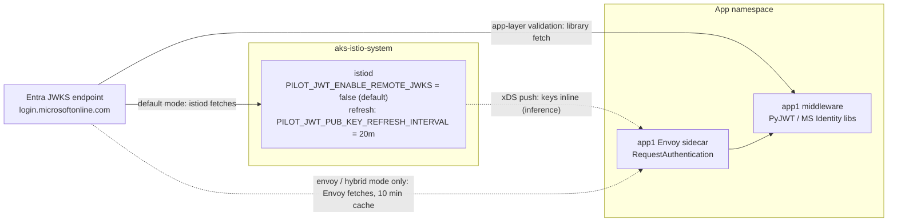
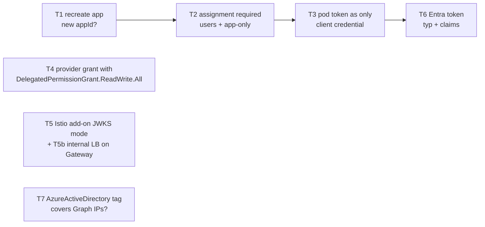

# Zero-Trust AKS Portal Architecture verified 2

Report date: 2026-11-09 · Brief: `briefs/Zero-Trust AKS Portal Architecture verified 2.md` · Notes: `research_notes/Zero-Trust AKS Portal Architecture verified 2/` · Earlier reports (unchanged): `reports/Zero-Trust AKS Portal Architecture.md`, `reports/Zero-Trust AKS Portal Architecture verified.md`

**Purpose.** This report closes the open items of the "verified" report, which fall into three groups:
- **Group 1:** answerable from a known primary source. Verified here.
- **Group 2:** answerable only by a sandbox test. A test plan is given in §3.
- **Group 3:** answerable only by Microsoft. A hand-over is given in §4.

**Method.** A targeted workflow, without open web search, handled 12 topics:
1. It fetched the **named primary URLs** for each topic.
2. It answered fixed questions with **verbatim quotes**.
3. Three independent verifiers per answer **re-fetched the source** and tried to refute it.

Result: **40 answers confirmed 3-0, 0 refuted, 2 questions not answered by the sources.**

In addition, the main session fetched the RFC 10017 publication status and cookie section directly, because one verifier side note disputed the status.

**Labels:** ✅ verified in this run · ✅¹ verified in an earlier run · ⚠️ inference · ❓ unverified.

**Abbreviations:**
- **BFF (Backend-for-Frontend):** server-side confidential OAuth client holding tokens for a browser UI.
- **FIC:** federated identity credential.
- **JWKS:** the identity provider's published signing keys.

---

## 1. Closure status of the open items

| # | Open item (from "verified" §10) | Result | Status |
|---|---|---|---|
| 1 | Internal load-balancer annotation | `service.beta.kubernetes.io/azure-load-balancer-internal: "true"`; subnet and static-IP annotations documented | ✅ closed |
| 2 | `.local` and mDNS | RFC 6762 designates `.local.` for mDNS and recommends against using it in unicast DNS | ✅ closed |
| 3 | RFC 9068 | `typ` `at+jwt`, required claims, `aud`/`iss` rules, SCIM-style `roles`/`groups` | ✅ closed |
| 4 | RFC 6750 | Header method preferred; error codes; TLS mandatory; no clear-text cookies | ✅ closed |
| 5 | IETF Browser-Based Apps (BFF) | **Published as RFC 10017, BCP 212, August 2026.** BFF is "strongly recommended" for business and sensitive applications | ✅ closed |
| 6 | cert-manager and trust-manager | CA issuer flagged as demo or expert-only; trust-manager distribution model confirmed | ✅ closed |
| 7 | azuread syntax | FIC arguments, `optional_claims`, `web`, `required_resource_access`, `sign_in_audience`, token version (**defaults to 1**) | ✅ closed |
| 8 | Istio JWKS fetching | **istiod fetches by default** (`PILOT_JWT_ENABLE_REMOTE_JWKS=false`), refreshing every **20 min** | ✅ closed. Inline push to Envoy is ⚠️; AKS add-on behaviour goes to test T5 |
| 9 | "Assignment required" | Applies to users **and** apps requesting tokens; Global Administrators are exempt | ✅ closed. Error code goes to test T2 |
| 10 | Narrowest permission for a delegated grant | Graph: **`DelegatedPermissionGrant.ReadWrite.All`** is least privileged | ✅ for Graph. Provider behaviour goes to test T4 |
| 11 | Firewall coverage of Entra and Graph | **`AzureActiveDirectory` service tag includes sign-in and MS Graph**, usable as an Azure Firewall destination | ✅ closed (former group 3). Exact IP coverage goes to test T7 |
| 12 | CAE revocation for custom APIs | Docs name Exchange, SharePoint and Teams as examples. **No documented way** for a custom API to receive critical events | Remains group 3 (§4) |

---

## 2. Findings and their consequences

### 2.1 BFF is now an IETF Best Current Practice ✅

**Status.** `draft-ietf-oauth-browser-based-apps` was published as **RFC 10017 (BCP 212, August 2026)**. The main session checked this directly: the rfc-editor.org header reads "Category: Best Current Practice … August 2026" ([RFC 10017][rfc10017]).

**Definition (§6.1).** The BFF is a confidential client. It manages access and refresh tokens "in the context of a cookie-based session, avoiding the direct exposure of any tokens to the browser-based application". It forwards requests to the resource server with the right access token.

**Recommendation.** The BFF is "strongly recommended for business applications, sensitive applications, and applications that handle personal data". The patterns are presented "in decreasing order of security". Per §6.3, the browser-based OAuth client is *not* recommended for those application classes.

**Cookie rules (§6.1.3.2):**

| Rule | Level |
|---|---|
| `Secure` | MUST |
| `HttpOnly` | MUST |
| `SameSite=Strict` | SHOULD |
| `Path=/` | SHOULD |
| No `Domain` attribute | SHOULD NOT set it |
| `__Host-Http-` name prefix | SHOULD |

The RFC notes that the SHOULDs are not MUSTs only so that existing architectures can comply.

**Consequences ⚠️:**
- The first report's glossary entry for BFF and its pattern recommendation ("avoid the pure SPA for internal enterprise apps") now rest on a BCP, not on inference.
- Two of the RFC's cookie SHOULDs bear directly on a portal on `portal.internal…`:
  - **No `Domain` attribute and the `__Host-Http-` prefix.** These keep the session cookie host-only, so `app1.internal…` can't read or overwrite it.
  - **`SameSite=Strict`.** It is compatible with the per-app sign-in pattern, because each app sets its own host-only cookie after its own redirect.

### 2.2 Tokens and validators: RFC 9068 and RFC 6750 ✅

**RFC 9068** ([RFC 9068][rfc9068]):
- **`typ` header.** JWT access tokens MUST carry `typ` `at+jwt`. Resource servers MUST verify that `typ` is `at+jwt` or `application/at+jwt` and reject anything else.
- **Required claims:** `iss`, `exp`, `aud`, `sub`, `client_id`, `iat`, `jti`.
- **Issuer and audience.** `iss` MUST exactly match the issuer identifier. `aud` MUST contain the resource server's own identifier, or the token is rejected.
- **Authorization attributes.** These SHOULD use the SCIM `groups`, `roles` and `entitlements` claim types.

**Consequence ⚠️.** Entra ID access tokens are, by inference, not RFC 9068 profile tokens: they typically carry `typ: JWT` ❓, and v2 tokens use `azp` rather than `client_id` ❓. So:
- **Do not enforce `typ == at+jwt`** in your validators for Entra tokens, or every request will be rejected.
- RFC 9068's `aud`/`iss` rules still apply and match the earlier reports' checklist ✅¹.

Test T6 checks the real header and claims.

**RFC 6750** ([RFC 6750][rfc6750]):
- **How the token is sent.** Clients SHOULD use `Authorization: Bearer`, and resource servers MUST support it. The form-body method SHOULD NOT be used except where the header is unavailable. The query parameter SHOULD NOT be used; a verifier notes that RFC 9700 (2025) tightens this to MUST NOT ❓.
- **Errors.** `invalid_request` → 400, `invalid_token` → 401, `insufficient_scope` → 403 (SHOULD). If the request has no authentication information, the response SHOULD NOT include an error code.
- **Transport and storage.** Clients MUST use TLS. Implementations MUST NOT store bearer tokens in cookies that can be sent in the clear; if tokens are stored in cookies, there MUST be CSRF protection.

**Consequence.** The validation checklist's 401/403 split ✅¹ matches RFC 6750. Return `WWW-Authenticate: Bearer error="invalid_token"` on token failures and `error="insufficient_scope"` with 403 on a missing role ⚠️. RFC 6750's scope wording maps naturally onto roles.

### 2.3 Istio JWKS: istiod fetches by default ✅



*Figure 1. Who fetches Entra's signing keys. Sources:*
- *✅ `PILOT_JWT_ENABLE_REMOTE_JWKS`: `istiod`/`false` → istiod fetches. `hybrid`/`true` → Envoy, falling back to istiod if the JWKS server is external. `envoy` → Envoy. Default `false`. Refresh interval `PILOT_JWT_PUB_KEY_REFRESH_INTERVAL`, default `20m0s`; JWKS fetch timeout 5 s ([pilot-discovery][istio-pd]).*
- *✅ Envoy's 10 min remote cache is from the "verified" report.*
- *⚠️ Inference: that istiod pushes the keys inline.*
- *❓ Unverified: whether the AKS add-on keeps the upstream default or allows changing it. That is test T5.*

**Consequences ⚠️:**
- **Egress.** For the sidecar layer, it's **istiod** (in `aks-istio-system`) that needs egress to `login.microsoftonline.com`, not the app pods. This settles the "JWKS egress subtlety" left open in the first report §7. The app pods still need that egress for **in-app validation** and for the BFF's or app's token calls.
- **Key rollover.** After an emergency Entra key rollover, the sidecar layer may reject new tokens for up to the istiod refresh interval (≤ 20 min by default). App-layer libraries refetch on an unknown `kid` (PyJWT after a ≥ 30 s cooldown ✅¹). This argues for one of two setups:
  - (a) Keep the sidecar `RequestAuthentication` coarse and let the app layer be authoritative, as the reports already recommend.
  - (b) Shorten the refresh interval, if the add-on allows it ❓.

### 2.4 Entra registration details for the Terraform module ✅

([azuread_application docs][tf-app], [FIC resource docs][tf-fic], [servicePrincipal][graph-sp], [enterprise-app properties][ms-props], [oauth2PermissionGrant create][graph-grant])

**`requested_access_token_version` defaults to `1`.** It must be set to `2` explicitly, as the "verified" sketch does. Without it, `aud` is the App ID URI and the issuer is v1, contrary to the validation checklist.

**`sign_in_audience`** defaults to `AzureADMyOrg` (single tenant), which is correct here.

**`optional_claims`:**
```hcl
optional_claims {
  access_token { name = "xms_cc" }
}
```
Blocks are repeatable. `additional_properties` is a list of strings.

**The `web` block** has `redirect_uris` ("valid `http` URL or a URN"; the provider does not enforce https), `logout_url` (front-channel, back-channel or SAML logout) and `homepage_url`.

**`required_resource_access`** takes a `resource_app_id` (the target's client ID) plus `resource_access { id, type = "Role" | "Scope" }`.

**`azuread_application_federated_identity_credential`:**
- Required arguments: `application_id`, `audiences`, `display_name`, `issuer`, `subject`.
- **`application_id` is the resource ID** (`azuread_application.x.id`, form `/applications/{object_id}`), not the client ID.
- Changing `application_id` or `display_name` forces replacement.
- Needs `Application.ReadWrite.OwnedBy` (as owner) or `Application.ReadWrite.All`.

The "verified" sketch is consistent with all of the above.

**"Assignment required" (`appRoleAssignmentRequired`):**
- It covers users **and** "other applications or services … requesting access tokens", so it also gates app-only tokens.
- **Global Administrators can sign in regardless.**
- It applies to SAML, OIDC, OAuth 2.0, WS-Fed and App Proxy apps.

Consequence ⚠️: with it on, a backend calling an API app-only needs an app-role assignment on that API, or it gets no token.

**Delegated grant permission.** Graph lists **`DelegatedPermissionGrant.ReadWrite.All`** as the least-privileged permission for `POST /oauth2PermissionGrants` (higher: `Directory.ReadWrite.All`). It can grant delegated permissions for **any** API, Microsoft Graph included. The reference page labels no permission as "highly privileged", so treat it as tier-0 anyway ⚠️. The azuread provider docs still list only `Directory.ReadWrite.All` ✅¹. Whether the provider works with the narrower permission is test T4.

### 2.5 Egress: the `AzureActiveDirectory` service tag ✅

([service tags][svc-tags], [Firewall FQDN tags][fw-fqdn])
- **What the tag covers.** "Microsoft Entra ID Services. This tag includes sign-in, MS Graph and other Microsoft Entra services". Direction: outbound; not regional; **usable with Azure Firewall**, but as a **destination only**. It is also usable in NSG rules.
- **No other tags help.** There is no separate Graph service tag, and none of the Azure Firewall **FQDN tags** mentions Entra or Graph. FQDN tag contents aren't published or customizable.

**Consequence ⚠️.** This closes the firewall question from the "verified" report §6.1. For Entra **and** Graph egress through Azure Firewall, use a **network rule with destination service tag `AzureActiveDirectory` on TCP 443**, or explicit application rules for `login.microsoftonline.com` and `graph.microsoft.com`. Don't rely on the `AzureKubernetesService` FQDN tag.

Microsoft's description says the tag includes Graph, but it doesn't list IP prefixes, so whether *every* Graph endpoint falls inside the tag's ranges is test T7.

### 2.6 Ingress: internal load balancer ✅

([internal LB][aks-ilb], page dated 2026-07-31)
- **Internal LB.** `service.beta.kubernetes.io/azure-load-balancer-internal: "true"` on a `LoadBalancer` Service gives a private frontend IP and no public IP. The IP is assigned from the cluster subnet by default.
- **Subnet.** `…/azure-load-balancer-internal-subnet` takes a subnet name in the same VNet.
- **Static IP.** `…/azure-load-balancer-ipv4` (or `-ipv6`) is recommended over the deprecated `spec.loadBalancerIP`. The IP must be free in the subnet and not Azure-reserved or from the service CIDR.
- **Permissions.** The cluster identity needs Network Contributor, or `subnets/join/action` + `subnets/read`, when the subnet is your own.
- **Private Link Service.** `azure-pls-create: "true"` is documented.
- **Gap.** The page has no example for an ingress controller or gateway behind the internal LB.

**Consequence ⚠️.** For a Gateway API `Gateway` on the Istio add-on, the annotation has to reach the generated Service. How the add-on passes Service annotations from a `Gateway` (e.g. `spec.infrastructure.annotations`) is ❓ and is covered by test T5b.

### 2.7 Certificates: cert-manager and trust-manager ✅

([CA issuer][cm-ca], [Issuer concepts][cm-issuer], [trust-manager][cm-trust])

**CA issuer:**
- It signs leaf certificates with a CA cert and key held **in a Kubernetes Secret** (`tls.crt`/`tls.key`).
- The docs warn: "CA issuers are generally for cert-manager demos or for advanced users with experience and tooling for running a PKI … If you're not planning to run your own PKI, use a different issuer type."
- For an intermediate CA, `tls.crt` must hold the full chain.

**Issuer vs ClusterIssuer:**
- An `Issuer` is namespaced and can't issue for other namespaces.
- A `ClusterIssuer` reads its Secret from the **Cluster Resource Namespace** (default `cert-manager`).

**trust-manager:**
- A `Bundle` collects certificates from sources in the trust-manager namespace (ConfigMap, Secret, inline, default CAs) and writes them to same-named ConfigMap or Secret targets.
- Targets are filtered by `namespaceSelector`. **An empty selector currently means all namespaces**, and a planned change will alter this.
- The docs warn that using the issuer's Secret directly as a source "IS NOT SAFE … in production" because it breaks CA rotation.
- A verifier notes the planned `Bundle` → `ClusterBundle` API migration ❓.

**Consequences ⚠️:**
- **Gateway TLS certificate.** Don't hold a corporate intermediate CA key in a cluster Secret unless you run a PKI. Prefer an external-issuer type that signs in your PKI (e.g. Vault PKI or a vendor issuer ❓), or issue the gateway certificate outside the cluster and sync it through Key Vault and CSI.
- **Use a namespaced `Issuer`** in the app namespace, not a `ClusterIssuer`, if certificates should stay within the namespace boundary.
- **trust-manager.** Copy the corporate root into a dedicated ConfigMap as the source. Set `namespaceSelector` explicitly to the app namespace. Pin the trust-manager version because of the API migration.

### 2.8 Hostnames: `.local` ✅

([RFC 6762][rfc6762])
- **Reserved for mDNS.** Names ending in `.local.` are link-local, and queries for them "MUST be sent to the mDNS … multicast address". Using `.local` as a private top-level domain "conflicts with Multicast DNS and may cause problems for users" (Appendix G).
- **Alternatives.** The RFC recommends no unregistered top-level domain at all. It lists `.intranet`, `.internal`, `.private`, `.corp`, `.home` and `.lan` as having been used without the `.local` conflict.

**Consequence.** Replace `*.internal.company.local` with a subdomain of a domain you own (e.g. `*.internal.company.com`). A verifier mentions ICANN's 2024 reservation of `.internal` ❓, which would make that the alternative if a non-public TLD is wanted.

### 2.9 CAE: scope ✅ / revocation gap stays open

([CAE concept][cae-concept], [claims challenge][ms-cc])
- **Critical events.** These are delivered to subscribing services "like Exchange Online, SharePoint Online, and Teams". That is a list of examples, not a closed list. No page describes how a custom API could subscribe to or receive them.
- **What custom APIs can do.** Request `xms_cc`, detect `cp1`, and issue 401 `insufficient_claims` claims challenges, including for **Conditional Access authentication context** (step-up, `acrs`). Enforcing IP location is described only for resource providers that sync policy from Entra.

**Consequence.** No change. Treat the claims challenge as a **step-up** mechanism, and the access-token lifetime (60–90 min ✅¹) as the revocation exposure window. The remaining question goes to Microsoft (§4).

---

## 3. Group 2: sandbox test plan

**Scope.** These are things documentation can't settle. The tests were **not executed in this session**, which has no Azure tenant or cluster.

**Environment:**
- A non-production Entra tenant, or an isolated test tenant.
- An AKS cluster with OIDC issuer, workload identity and the Istio add-on.
- Azure Firewall on the egress path, for T7.
- Tools: `az`, `terraform`, `kubectl`, `istioctl` matching the add-on revision, `jq`.

**Evidence to capture per test:** command output, timestamps, and the error codes seen. Record them in a later `… verified 3` notes file, so the results can be cited.



*Figure 2. Test dependencies. T1–T3 share one throwaway registration; T4, T5 and T7 are independent.*

### T1: Recreating a registration changes the client ID

| | |
|---|---|
| **Question** | Does destroy + apply of an `azuread_application` produce a new `client_id`? Can a soft-deleted app be restored with its original ID? |
| **Setup** | Terraform module from "verified" §3.3 with **no** `prevent_destroy`, for a throwaway app `zt-test-recreate`. |
| **Steps** | 1. `terraform apply` → record `client_id` and `object_id`.<br/>2. `terraform destroy -target=azuread_application.app["zt-test-recreate"]`.<br/>3. `az rest -m GET -u "https://graph.microsoft.com/v1.0/directory/deletedItems/microsoft.graph.application"` → confirm the app is soft-deleted.<br/>4. `terraform apply` → record the new `client_id`.<br/>5. Optional: restore the deleted object (`POST /directory/deletedItems/{id}/restore`) on a second throwaway app and compare IDs. |
| **Pass criteria** | Step 4's `client_id` ≠ step 1's ⇒ `prevent_destroy` is justified. The restored app keeps its original `client_id` ⇒ document restore as the recovery path. |
| **Cleanup** | Destroy, then permanently delete from deleted items. |

### T2: What "Assignment required" does

| | |
|---|---|
| **Question** | Exact error for an unassigned user. Is an app-only token denied without an app-role assignment? Confirm the Global Administrator exemption. |
| **Setup** | App A (`app_role_assignment_required = true`, one app role `Test.Read` with `allowed_member_types = ["User","Application"]`, redirect `http://localhost:8400/`). Users U1 (assigned) and U2 (unassigned). Client app C with a certificate credential and no role on A. |
| **Steps** | 1. Open the `/authorize` URL for A as U1, then as U2 (private browser windows).<br/>2. As C: `POST /token` `grant_type=client_credentials`, `scope=api://<A>/.default`.<br/>3. Assign `Test.Read` to C (app role assignment) and repeat step 2.<br/>4. Optional: repeat step 1 with a Global Administrator who is not assigned. |
| **Pass criteria** | U1 gets a code. U2 gets an error (expected AADSTS50105 ❓). C is denied in step 2 and gets a token with `roles: ["Test.Read"]` in step 3. The GA signs in (✅ per docs). |
| **Cleanup** | Delete A and C, remove the test users. |

### T3: Pod token as the only client credential for interactive sign-in

| | |
|---|---|
| **Question** | Can a user-facing web app or BFF on AKS complete the auth-code flow with the workload-identity token as its only credential, with no secret and no certificate? |
| **Setup** | App registration W with **no** password or certificate (`az ad app credential list --id <W>` → empty). FIC: issuer = cluster OIDC issuer, subject `system:serviceaccount:zt-test:webapp`, audience `api://AzureADTokenExchange`. Service account `webapp` annotated `azure.workload.identity/client-id: <W>`; pod label `azure.workload.identity/use: "true"`. Redirect URI `http://localhost:8080/signin-oidc`. |
| **App** | Either ASP.NET Core with Microsoft.Identity.Web, `ClientCredentials: [{ SourceType: "SignedAssertionFilePath" }]` (the projected token path comes from `AZURE_FEDERATED_TOKEN_FILE`). Or Python MSAL `ConfidentialClientApplication(client_credential={"client_assertion": <file contents>})` with the file **re-read for each token request** ❓. |
| **Steps** | 1. `kubectl port-forward deploy/webapp 8080`.<br/>2. Sign in through a browser.<br/>3. Check the app received an ID token with `roles`.<br/>4. Negative test: change the FIC subject to a wrong SA name, wait ≥ 1 min, retry. |
| **Pass criteria** | Sign-in succeeds with no secret. The negative test fails at code redemption (expected AADSTS70021 / 700213-class "no matching federated identity record" ❓). Record the package versions used. This answers the "verified" report's open question about the minimum version. |
| **Cleanup** | Delete the namespace and W. |

### T4: Delegated grant through the provider with the narrowest permission

| | |
|---|---|
| **Question** | Does `azuread_service_principal_delegated_permission_grant` work when the Terraform SP has only `DelegatedPermissionGrant.ReadWrite.All` (+ `Application.Read.All`), not `Directory.ReadWrite.All`? |
| **Setup** | Terraform SP T with `Application.ReadWrite.OwnedBy`, `Application.Read.All` and `DelegatedPermissionGrant.ReadWrite.All` (admin-consented). Resource app R exposes the scope `Access`. Client app P (portal) is owned by T. |
| **Steps** | 1. `terraform apply` the grant: `service_principal_object_id` = P's SP, `resource_service_principal_object_id` = R's SP, `claim_values = ["Access"]`.<br/>2. Verify: `az rest -m GET -u "https://graph.microsoft.com/v1.0/oauth2PermissionGrants?\$filter=clientId eq '<P-sp-id>'"`.<br/>3. If step 1 fails, record the error and retry with `Directory.ReadWrite.All` to confirm the difference. |
| **Pass criteria** | The grant is created ⇒ the narrower permission is enough, and pipeline B (from "verified" §3.1) can drop `Directory.ReadWrite.All`. Failing that, record `Authorization_RequestDenied` and keep consent as a manual or IAM-owned step. |
| **Cleanup** | Destroy the grant, remove T's permissions. |

### T5: AKS Istio add-on JWKS mode and refresh (+ T5b internal LB on a Gateway)

| | |
|---|---|
| **Question** | Does the add-on keep `PILOT_JWT_ENABLE_REMOTE_JWKS=false` (istiod fetches, keys inline)? What is its refresh interval, and can it be changed? How is a Gateway Service made internal? |
| **Steps (T5)** | 1. `kubectl -n aks-istio-system get deploy -l app=istiod -o json \| jq '.items[].spec.template.spec.containers[].env[] \| select(.name\|test("JWT"))'`.<br/>2. Apply a `RequestAuthentication` for a test workload, with `jwksUri` = Entra tenant keys.<br/>3. `istioctl -i aks-istio-system proxy-config listener <pod> -n zt-test -o json \| jq '..\|.local_jwks? // empty, ..\|.remote_jwks? // empty'`.<br/>4. Check whether the add-on's `shared configmap` / MeshConfig allow-list exposes either variable ([Istio add-on][aks-istio] ✅¹ lists blocked customizations). |
| **Pass criteria** | `local_jwks` present ⇒ istiod mode, as upstream defaults. Record the env values. If the refresh interval can't be changed, accept ≤ 20 min sidecar lag after an emergency key rollover and keep app-layer validation authoritative. |
| **Steps (T5b)** | Create a Gateway API `Gateway` (`gatewayClassName: istio`) with `spec.infrastructure.annotations: { service.beta.kubernetes.io/azure-load-balancer-internal: "true" }` ❓. Check that `kubectl get svc` shows a private EXTERNAL-IP and that no public IP resource was created. |
| **Cleanup** | Delete the test namespace and Gateway. |

### T6: Entra access-token header and claims against RFC 9068

| | |
|---|---|
| **Question** | What `typ`, `ver`, `iss`, `aud`, `azp`/`client_id` does an Entra v2 access token for your API actually carry? |
| **Steps** | Acquire a token for A (from T2) with `requested_access_token_version = 2`. Decode the header and payload locally (never paste tokens into online decoders): `python3 -c 'import sys,jwt; t=sys.argv[1]; print(jwt.get_unverified_header(t)); print(jwt.decode(t, options={"verify_signature": False}))' "$TOKEN"`. |
| **Pass criteria** | Record `typ` (expected `JWT` ❓). `aud` = A's client ID ✅¹. `iss` = `https://login.microsoftonline.com/<tid>/v2.0` ✅¹. Note whether there is a `client_id` claim or only `azp`. The result settles whether any shared middleware may enforce RFC 9068's `typ` check. |

### T7: Does the `AzureActiveDirectory` service tag cover Graph?

| | |
|---|---|
| **Question** | Do the current IPs of `graph.microsoft.com` and `login.microsoftonline.com` fall inside the tag's prefixes? |
| **Steps** | 1. `az network list-service-tags --location <region> --query "values[?name=='AzureActiveDirectory'].properties.addressPrefixes" -o json > aad.json`.<br/>2. From a pod, resolve both hosts (several times, over a day).<br/>3. Check each IP against the prefixes (Python `ipaddress`).<br/>4. Through Azure Firewall, with only a network rule `AzureActiveDirectory:443` allowed, call `GET https://graph.microsoft.com/v1.0/$metadata` and the JWKS URL. |
| **Pass criteria** | All resolved IPs are covered and both calls succeed ⇒ the network rule suffices. Otherwise add FQDN application rules. |

---

## 4. Group 3: hand-over to Microsoft

Only one item remains that documentation and tests can't close.

| Question for Microsoft (support case or account team) | Why it matters | Interim stance |
|---|---|---|
| Can a custom line-of-business API registered in our tenant receive CAE critical events (user disabled, password reset, risk elevated) so that access tokens are revoked in near real time? If so, by what mechanism? | It decides whether the revocation window is token lifetime (60–90 min) or near real time. | Assume token lifetime. Use claims challenges only for step-up. Use short app-session timeouts and Conditional Access sign-in frequency for re-authentication. |

The firewall question from the "verified" report has moved to §2.5 (documented) and test T7 (exact IP coverage).

---

## 5. Corrections to the earlier reports

The earlier reports stay unchanged. Apply these when you use them.

| Report, section | Earlier text | Correction |
|---|---|---|
| First report, §2.1 glossary, BFF | IETF draft BCP, ❓ | **RFC 10017, BCP 212 (Aug 2026)** ✅. Add the cookie rules from §2.1 here. |
| First report, §4.3 | Pattern recommendation ⚠️ | Backed by RFC 10017 §6 ("strongly recommended for business applications…") ✅. |
| First report, §7, "JWKS egress subtlety" | istiod vs sidecar ❓ | Upstream default: **istiod** fetches, every 20 min ✅. The add-on is confirmed by T5. |
| First report, §6 | `.local` collides with mDNS ❓ | ✅ RFC 6762 §3 and Appendix G. |
| First report, §6 | Internal LB annotation ❓ | ✅ plus the subnet and static-IP annotations (§2.6). |
| First report, §9 | cert-manager as the gateway certificate issuer ❓ | ✅ mechanics; ⚠️ use a CA issuer only with PKI tooling; prefer an external issuer or Key Vault (§2.7). |
| "Verified", §3.2 | `DelegatedPermissionGrant.ReadWrite.All` ❓ | ✅ least privileged per Graph; provider behaviour → T4. |
| "Verified", §6.1 | Firewall: explicit application rules | ✅ alternative: **`AzureActiveDirectory`** service tag as a network-rule destination (includes sign-in and Graph). IP coverage → T7. |
| "Verified", §3.3 | `app_role_assignment_required` effect ❓ | ✅ gates users **and** app-only tokens; Global Administrators are exempt. |
| All validators | — | Do **not** enforce RFC 9068 `typ == at+jwt` on Entra tokens until T6 shows the header ⚠️. |

---

## 6. Still unverified after this run

- **Error codes:** the error an unassigned user sees (AADSTS50105) → T2. The FIC-mismatch error code → T3.
- **Istio inline JWKS push** to Envoy, and the add-on's configurability of the JWKS settings → T5.
- **Gateway API internal LB** via `spec.infrastructure.annotations` on the Istio add-on → T5b.
- **Entra token format:** `typ` header and `client_id` vs `azp` → T6.
- **Firewall coverage:** whether the `AzureActiveDirectory` tag's IP ranges cover all Graph endpoints → T7.
- **RFC 9700** tightening the query-parameter rule to MUST NOT; **ICANN's `.internal` reservation**; the **trust-manager `ClusterBundle` migration** details. All three are verifier side notes, not verified.
- **CAE critical events for custom APIs** → Microsoft (§4).

---

## Sources

All of the following were fetched by the extraction agent and re-fetched by three verifiers. RFC 10017 was also fetched directly by the main session.

- [rfc10017]: https://www.rfc-editor.org/rfc/rfc10017.txt (BCP 212, August 2026) · datatracker: https://datatracker.ietf.org/doc/draft-ietf-oauth-browser-based-apps/
- [rfc9068]: https://www.rfc-editor.org/rfc/rfc9068 (October 2021)
- [rfc6750]: https://www.rfc-editor.org/rfc/rfc6750 (October 2012)
- [rfc6762]: https://www.rfc-editor.org/rfc/rfc6762 (February 2013)
- [istio-pd]: https://istio.io/latest/docs/reference/commands/pilot-discovery/
- [istio-ra]: https://istio.io/latest/docs/reference/config/security/request_authentication/
- [tf-app]: https://raw.githubusercontent.com/hashicorp/terraform-provider-azuread/main/docs/resources/application.md
- [tf-fic]: https://raw.githubusercontent.com/hashicorp/terraform-provider-azuread/main/docs/resources/application_federated_identity_credential.md
- [graph-sp]: https://learn.microsoft.com/en-us/graph/api/resources/serviceprincipal
- [ms-props]: https://learn.microsoft.com/en-us/entra/identity/enterprise-apps/application-properties
- [graph-grant]: https://learn.microsoft.com/en-us/graph/api/oauth2permissiongrant-post
- [graph-perms]: https://learn.microsoft.com/en-us/graph/permissions-reference
- [svc-tags]: https://learn.microsoft.com/en-us/azure/virtual-network/service-tags-overview
- [fw-fqdn]: https://learn.microsoft.com/en-us/azure/firewall/fqdn-tags
- [aks-ilb]: https://learn.microsoft.com/en-us/azure/aks/internal-lb
- [cm-ca]: https://cert-manager.io/docs/configuration/ca/
- [cm-issuer]: https://cert-manager.io/docs/concepts/issuer/
- [cm-trust]: https://cert-manager.io/docs/trust/trust-manager/
- [cae-concept]: https://learn.microsoft.com/en-us/entra/identity/conditional-access/concept-continuous-access-evaluation
- [ms-cc]: https://learn.microsoft.com/en-us/entra/identity-platform/claims-challenge (linked from https://learn.microsoft.com/en-us/entra/identity-platform/app-resilience-continuous-access-evaluation)
- [aks-istio]: https://learn.microsoft.com/en-us/azure/aks/istio-about (from the first report)

[rfc10017]: https://www.rfc-editor.org/rfc/rfc10017.txt
[rfc9068]: https://www.rfc-editor.org/rfc/rfc9068
[rfc6750]: https://www.rfc-editor.org/rfc/rfc6750
[rfc6762]: https://www.rfc-editor.org/rfc/rfc6762
[istio-pd]: https://istio.io/latest/docs/reference/commands/pilot-discovery/
[tf-app]: https://raw.githubusercontent.com/hashicorp/terraform-provider-azuread/main/docs/resources/application.md
[tf-fic]: https://raw.githubusercontent.com/hashicorp/terraform-provider-azuread/main/docs/resources/application_federated_identity_credential.md
[graph-sp]: https://learn.microsoft.com/en-us/graph/api/resources/serviceprincipal
[ms-props]: https://learn.microsoft.com/en-us/entra/identity/enterprise-apps/application-properties
[graph-grant]: https://learn.microsoft.com/en-us/graph/api/oauth2permissiongrant-post
[svc-tags]: https://learn.microsoft.com/en-us/azure/virtual-network/service-tags-overview
[fw-fqdn]: https://learn.microsoft.com/en-us/azure/firewall/fqdn-tags
[aks-ilb]: https://learn.microsoft.com/en-us/azure/aks/internal-lb
[cm-ca]: https://cert-manager.io/docs/configuration/ca/
[cm-issuer]: https://cert-manager.io/docs/concepts/issuer/
[cm-trust]: https://cert-manager.io/docs/trust/trust-manager/
[cae-concept]: https://learn.microsoft.com/en-us/entra/identity/conditional-access/concept-continuous-access-evaluation
[ms-cc]: https://learn.microsoft.com/en-us/entra/identity-platform/claims-challenge
[aks-istio]: https://learn.microsoft.com/en-us/azure/aks/istio-about
