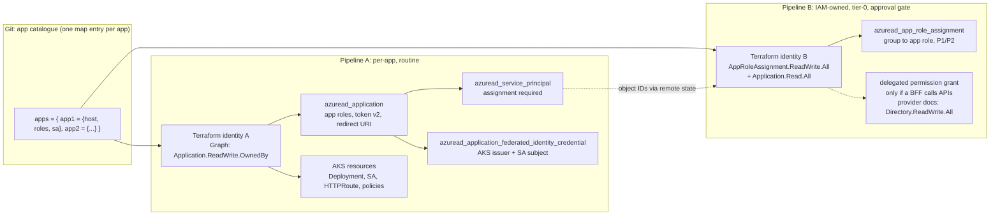
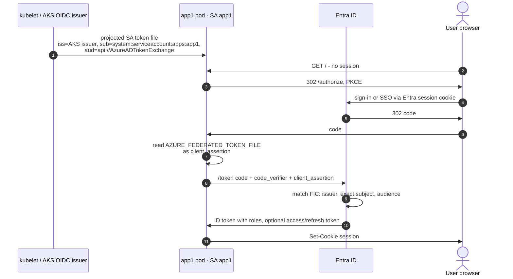
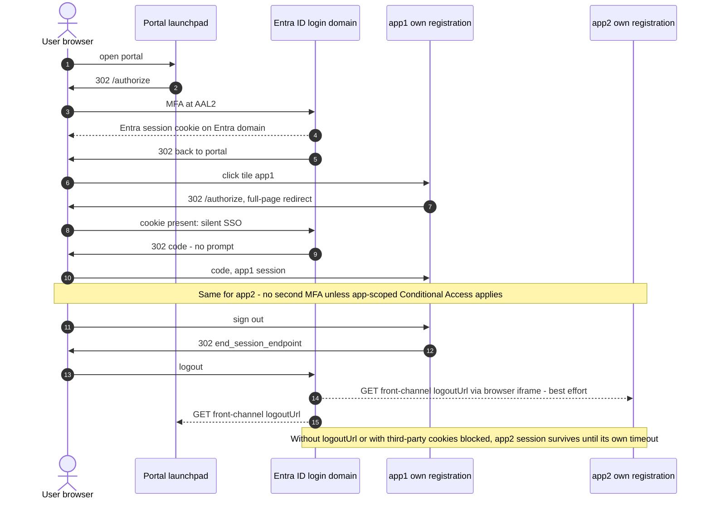
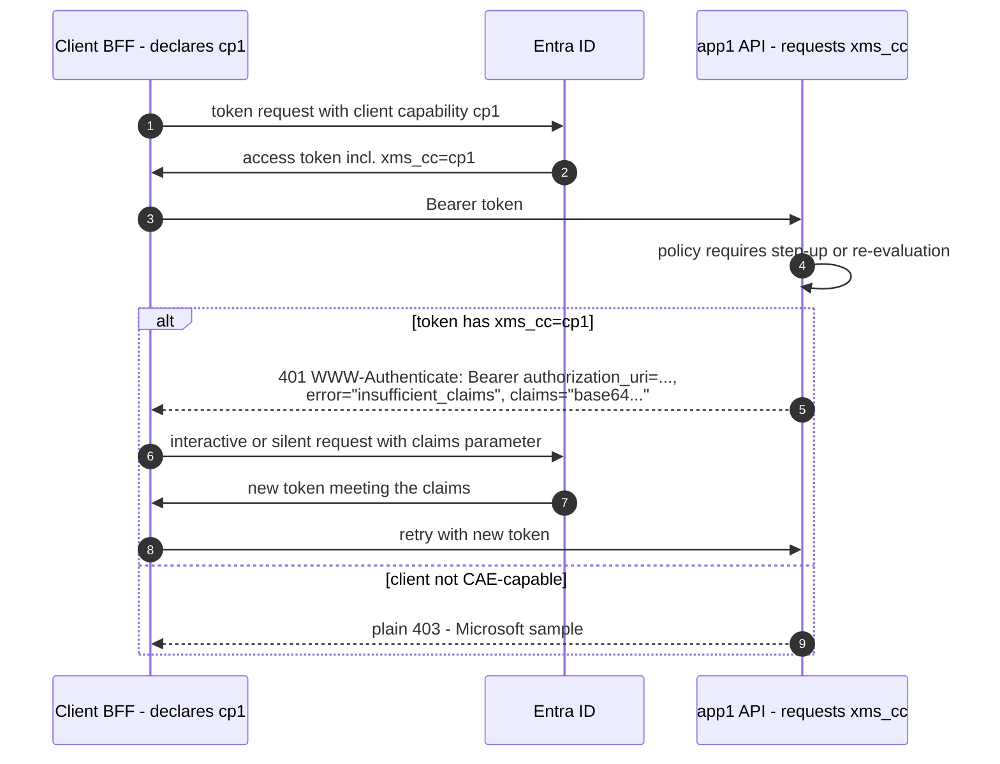

# Zero-Trust AKS Portal Architecture verified

Report date: 2026-11-09 · Brief: `briefs/Zero-Trust AKS Portal Architecture verified.md` · Notes: `research_notes/Zero-Trust AKS Portal Architecture verified/` · Earlier report (unchanged): `reports/Zero-Trust AKS Portal Architecture.md`

**Purpose.** This report verifies the first report's open and unverified items. It also answers the question raised afterwards: *Entra app registrations are manual work. Can a single SSO launchpad avoid registering every app, and if not, how can registrations be automated?*

**Method.** A deep-research workflow covered 6 search angles and fetched 34 sources (Microsoft Learn, Microsoft Graph reference, HashiCorp provider docs, Envoy, Gateway API spec, NIST, PyJWT). It extracted 168 claims and selected 48 for verification **round-robin across angles**, so that no topic was starved as in the first run. Each claim got 3 adversarial votes. Result: **44 confirmed, 4 refuted**.

**Labels:** ✅ verified in this run · ✅¹ verified in the first run · ⚠️ inference · ❓ unverified.

**Terms used before the glossary:**
- **BFF (Backend-for-Frontend):** a server-side confidential OIDC client that holds tokens for a browser UI and gives the browser only a session cookie.
- **FIC (federated identity credential):** a trust entry on an app registration that accepts an external token, here an AKS service-account token, in place of a secret.

---

## 1. What changed since the first report

| # | Topic | First report said | Now | Status |
|---|---|---|---|---|
| 1 | FQDN egress prerequisites | Open: a claim was refuted 1-2 | **Advanced Container Networking Services (ACNS) security** + **Azure CNI powered by Cilium** + **Kubernetes ≥ 1.29**. ACNS is a paid add-on. | ✅ |
| 2 | Azure Firewall as an egress alternative | ❓ | The `AzureKubernetesService` FQDN tag covers AKS's required FQDNs, including `login.microsoftonline.com`. It does **not** list `graph.microsoft.com`. Add explicit application rules. | ✅ 2-1 / ⚠️ |
| 3 | Envoy JWKS cache | ❓ | The Envoy `jwt_authn` remote JWKS cache defaults to **10 min**. Without `async_fetch`, the first requests wait for the fetch. Whether istiod inlines the keys on the AKS add-on is still ❓. | ✅ / ❓ |
| 4 | PyJWT snippet (§5.2) | Parameters ❓ | Defaults: `cache_jwk_set=True`, `lifespan=300`, `cache_keys=False`. On an unknown `kid` it refetches once, at most every **30 s** (`cooldown_duration`, recent versions only). Snippet updated in §6.3. | ✅ |
| 5 | CAE for custom APIs | "Implement claims challenge" | The mechanism is confirmed (`cp1`, `xms_cc`, 401 `insufficient_claims`). Whether CAE *revocation events* reach a custom API is **not** confirmed. Don't count on it. | ✅ / ❓ |
| 6 | Gateway API scoping | Use `allowedRoutes: Selector` | The default is `from: Same`. With the Gateway, routes and TLS Secret all in the app namespace, no `ReferenceGrant` is needed and routes from other namespaces can't attach. | ✅ / ⚠️ |
| 7 | NIST SP 800-207 base | ❓ | Seven tenets. **Tenet 2:** network location alone does not imply trust. **Tenet 3:** per-session access; authentication to one resource doesn't grant another. PDP = PE + PA; the PA commands the PEPs. | ✅ |
| 8 | Secretless confidential clients | Not covered | Microsoft recommends federated credentials over certificates and never secrets. Microsoft.Identity.Web supports a **Kubernetes workload-identity assertion as the client credential** of a web app. | ✅ |
| 9 | BFF draft, RFC 9068/6750, `.local`/mDNS, internal-LB annotation, cert-manager | ❓ | **Still ❓.** None survived selection or verification. | ❓ |

---

## 2. Do all apps need their own Entra registration?

**Short answer: one registration per trust boundary, not per deployment.** A single SSO launchpad does not remove that need. Single sign-on comes from Entra's session cookie and works across any number of registrations ✅.

- **Facts behind the rule:**
  - An access token has one `aud`, and an API must reject other audiences ✅¹.
  - The `roles` claim carries only the roles of the token's registration ✅¹.
  - NIST tenet 3: "authentication and authorization to one resource will not automatically grant access to a different resource" ✅ ([SP 800-207][nist-207]).
- **Design rule ⚠️:** apps that must not accept each other's tokens need separate registrations. Apps with the same owner, data sensitivity and user population *may* share one registration with prefixed roles (`app1.Reader`). In that case a token for one works at the others; accept that consciously.
- **Simplification for apps with their own UI ⚠️.** Use the per-app OIDC sign-in pattern, with the portal as a link launchpad. The app reads `roles` from the **ID token** it receives at sign-in ✅¹ ("roles claim in your token (ID token for app, access token for APIs)") and keeps a server-side session. It needs no exposed API scope, no access token and no delegated-permission consent to another API. That removes the most privileged Terraform step (§3.2).

The cost of "one registration per boundary" is therefore **automation**, not user experience. §3 shows how to automate it at least privilege.

---

## 3. Automating Entra registrations with Terraform

### 3.1 Privilege split



*Figure 1. Two pipelines from one app catalogue. Basis:*
- *✅ Pipeline A: `Application.ReadWrite.OwnedBy` can create apps and manage only those it owns ([Graph permissions][graph-perms]).*
- *✅ Pipeline B: role assignments need `AppRoleAssignment.ReadWrite.All` (+ `Application.Read.All` or `Directory.Read.All`), or `Application.ReadWrite.All`, or `Directory.ReadWrite.All` ([provider: app_role_assignment][tf-ara]). The delegated grant resource documents `Directory.ReadWrite.All` ([provider: delegated grant][tf-dpg]; 2-1).*
- *⚠️ The split itself and the remote-state hand-off are inference.*

### 3.2 Permission facts ✅

| Need | Permission / role | Risk |
|---|---|---|
| Create and manage registrations and service principals | `Application.ReadWrite.OwnedBy` (application permission, admin consent). The Terraform principal **must be an owner** of each app it manages. | **Low.** It can't update apps it doesn't own, but it can still **list and read all** apps and service principals in the tenant. |
| Same, for any app | `Application.ReadWrite.All` | Higher. Microsoft warns that managing credentials lets an app act as other entities. It does not cover delegated grants. |
| Assign groups to app roles | `AppRoleAssignment.ReadWrite.All` + `Application.Read.All`/`Directory.Read.All` | **Tier-0.** Microsoft: "allow an application to grant additional privileges to itself, other applications, or any user". |
| Admin consent (delegated grant) via the provider | Provider documents `Directory.ReadWrite.All` (2-1). Whether `DelegatedPermissionGrant.ReadWrite.All` is enough is ❓. | Tier-0. Avoid it with the per-app sign-in pattern (§2) ⚠️. |
| Assign users or groups by hand (portal) | Cloud Application Administrator, Application Administrator, User Administrator, or the **service principal's owner** | Delegate to app owners if you don't automate assignments. |
| Group-based assignment | **Entra ID P1/P2**. **Nested groups don't cascade** (direct members only). | Design groups flat per app role. |

**Refuted 0-3, so not repeated as fact:** "only Privileged Role Administrator / Global Administrator can consent to application permissions", and "the delegated grant resource needs Global Administrator as a user".

### 3.3 Terraform module (corrected sketch) ⚠️

Resource shapes follow the provider docs. Fields marked ❓ were not individually verified.

```hcl
data "azuread_client_config" "current" {}

resource "random_uuid" "role" {                         # app_role.id must be a UUID ✅
  for_each = local.app_roles                            # key "app1.Reader"
  lifecycle { prevent_destroy = true }                  # role id must never change
}

resource "azuread_application" "app" {
  for_each         = var.apps
  display_name     = "aks-${each.key}"
  owners           = [data.azuread_client_config.current.object_id]  # required for OwnedBy ✅
  sign_in_audience = "AzureADMyOrg"                     # ❓ field default not verified

  api { requested_access_token_version = 2 }            # aud = appId ✅
  web {
    redirect_uris = ["https://${each.value.host}/signin-oidc"]       # ❓ syntax
    logout_url    = "https://${each.value.host}/signout-oidc"        # front-channel logout ✅ concept
  }

  dynamic "app_role" {
    for_each = each.value.roles
    content {
      id                   = random_uuid.role["${each.key}.${app_role.key}"].result
      value                = "${each.key}.${app_role.key}"
      display_name         = app_role.key
      description          = app_role.value
      allowed_member_types = ["User"]
    }
  }

  optional_claims {                                     # CAE readiness, §7 ✅ concept / ❓ syntax
    access_token { name = "xms_cc" }
  }
  lifecycle { prevent_destroy = true }                  # recreate = new appId ❓ (see §9)
}

resource "azuread_service_principal" "app" {
  for_each                     = var.apps
  client_id                    = azuread_application.app[each.key].client_id
  owners                       = [data.azuread_client_config.current.object_id]
  app_role_assignment_required = true                   # effect on issuance ❓ (see §9)
}

resource "azuread_application_federated_identity_credential" "aks" {  # ≤ 20 per app ✅
  for_each       = var.apps
  application_id = azuread_application.app[each.key].id
  display_name   = "aks-${var.cluster}-${each.key}"
  issuer         = var.aks_oidc_issuer_url
  subject        = "system:serviceaccount:${var.namespace}:${each.key}"  # exact match, no wildcards ✅
  audiences      = ["api://AzureADTokenExchange"]                        # exactly one ✅
}
```

**Pipeline B (separate state, separate identity):**

```hcl
resource "azuread_app_role_assignment" "group" {        # P1/P2, direct members only ✅
  for_each            = local.group_role_assignments
  app_role_id         = each.value.app_role_id          # from pipeline A outputs
  principal_object_id = each.value.group_object_id
  resource_object_id  = each.value.sp_object_id
}
```

**Migrating existing manual registrations ✅/⚠️:**
- Add the Terraform principal as **owner** of each existing registration *before* `terraform import`. Under `OwnedBy` it otherwise can't update them ✅.
- Keep the existing app-role UUIDs: hard-code them or import them. New UUIDs would orphan existing assignments ⚠️.

---

## 4. Secretless confidential clients on AKS



*Figure 2. A web app or BFF on AKS whose only client credential is the workload-identity token. Basis:*
- *✅ Microsoft.Identity.Web lists `SignedAssertionFilePath` "for Kubernetes workload identity" ([credentials overview][miw-cred]), and `AzureIdentityForKubernetesClientAssertion` reads `AZURE_FEDERATED_TOKEN_FILE` ([MSAL WIF][msal-wif]).*
- *✅ FIC limits: 20 per app, exact subject, one audience ([FIC considerations][fic]).*
- *⚠️ 2-1: the auth-code combination (steps 8–9) is shown in Microsoft.Identity.Web's web-app sample with a managed-identity assertion. The MSAL article only shows client credentials. No document shows the pod-file variant end to end, and no minimum package version is documented.*

**Guidance:**
- **Credential preference ✅** ([app-registration best practices][ms-bp]): managed identity as a FIC (strongly recommended), then a federated identity from another platform, then a certificate. **Never** a password secret. App management policies can block secrets tenant-wide.
- **One service account per app** in the namespace, and one FIC per (cluster × service account). The 20-FIC cap matters only with more than 20 clusters or service accounts per app ⚠️.
- **Wrong subjects fail late ✅.** A mistyped subject is accepted when the FIC is created and fails only at token exchange. Add a smoke test after deployment ⚠️.
- **Python apps:** MSAL Python's `ConfidentialClientApplication` accepts a client assertion ❓ (not verified in this run). Read the projected token file on each token request, because the file is rotated.

---

## 5. SSO, launchpad and sign-out



*Figure 3. Basis:*
- *✅ The Entra session cookie gives SSO across registrations ([MSAL.js SSO][msal-sso]; [OIDC protocol][ms-oidc]).*
- *✅ `end_session_endpoint` ends the session "for this application" only. Each app has one front-channel logout URL, which Entra calls for every app the user is signed in to.*
- *⚠️ "Best effort" is inference from iframe delivery.*

**Findings:**
- **Silent SSO ✅:** `prompt=none` returns an error instead of a prompt when SSO can't complete. Pair it with `login_hint`. MSAL.js `ssoSilent` uses a hidden iframe and **fails with AADSTS50058 when third-party cookies are blocked** (e.g. Safari). Server-side full-page redirects (BFF or per-app web sign-in) avoid this ⚠️.
- **Prompts that can still appear ✅:** account picker, first-use consent, app-scoped Conditional Access.
- **Single sign-out:** set `web.logoutUrl` on every registration (Terraform above). Also enforce short idle and absolute app-session timeouts, because front-channel logout is not guaranteed ⚠️.
- **My Apps as the launchpad ✅:** an app appears only if it is **visible and the user or their group is assigned**. Group assignment needs P1/P2 ([My Apps][myapps]). A tile is just a link, so internal URLs work only where the browser has network reach ⚠️. If discovery is the only goal, My Apps can replace a custom portal ⚠️.

---

## 6. Egress and signing-key caching

### 6.1 FQDN egress ✅

- **AKS-native:** ACNS Container Network Security on Azure CNI powered by Cilium, Kubernetes ≥ 1.29, with ACNS security enabled. ACNS is paid ([FQDN filtering][aks-fqdn]). Limits: no Kubernetes service names in FQDN rules; cluster-wide rules use `CiliumClusterwideNetworkPolicy`; Alpine/musl images can hit DNS search-domain issues. The refuted claim was a licensing *wording* (0-3), so take pricing from the pricing page.
- **Firewall alternative (2-1):** the Azure Firewall `AzureKubernetesService` FQDN tag is auto-updated and covers AKS's required FQDNs, including `login.microsoftonline.com:443` ([limit egress][aks-egress]). `graph.microsoft.com` and the `AzureActiveDirectory` service tag are not mentioned. **Add explicit application rules for `login.microsoftonline.com` and `graph.microsoft.com`** rather than relying on the AKS tag for app traffic ⚠️.

### 6.2 Key cache behaviour by layer

| Layer | Default cache | Unknown `kid` | Basis |
|---|---|---|---|
| Microsoft guidance | 24 h key TTL, hourly background refresh | Refresh at most once per 5 min | ✅¹ |
| .NET Identity libraries | ~12 h ± 1 h, last-known-good on failure | — | ✅¹ |
| Envoy `jwt_authn` remote JWKS | **10 min** (`cache_duration`). `async_fetch` prefetches on the main thread before the listener starts. | ❓ | ✅ ([Envoy proto][envoy]) |
| Istio on the AKS add-on | istiod may inline the JWKS unless `PILOT_JWT_ENABLE_REMOTE_JWKS` is set | ❓ | ❓ |
| PyJWT `PyJWKClient` | Set cache on, **300 s** | Refetch + retry once, ≥ 30 s apart (`cooldown_duration`) | ✅ ([PyJWT API][pyjwt]) |

### 6.3 Python validation core (updated)

```python
import jwt  # PyJWT, recent version (cooldown_duration exists) ✅
from jwt import PyJWKClient

TENANT = "<tenant-guid>"
API_CLIENT_ID = "<app1-client-id>"
ISSUER = f"https://login.microsoftonline.com/{TENANT}/v2.0"

_jwks = PyJWKClient(
    f"https://login.microsoftonline.com/{TENANT}/discovery/v2.0/keys",
    cache_jwk_set=True,      # default ✅
    lifespan=3600,           # MS: refresh hourly (default 300 s) ✅¹
    cooldown_duration=300,   # MS: unknown-kid refetch ≤ 1 per 5 min (default 30 s) ✅/✅¹
)

def authorize(token: str, required_role: str) -> dict:
    key = _jwks.get_signing_key_from_jwt(token)   # unknown kid → one refetch, else PyJWKClientError ✅
    claims = jwt.decode(
        token, key.key,
        algorithms=["RS256"],                      # RFC 8725 §3.1 ✅¹
        audience=API_CLIENT_ID, issuer=ISSUER,
        options={"require": ["exp", "nbf", "iss", "aud", "tid", "oid"]},
        leeway=60,
    )
    if claims["tid"] != TENANT:
        raise jwt.InvalidTokenError("tenant mismatch")
    if required_role not in claims.get("roles", []):
        raise PermissionError("missing role")      # → 403
    return claims
```

**Not verified ❓:**
- Whether a refresh after `lifespan` expires blocks the request path.
- Whether PyJWT keeps the last-known-good key set when a fetch fails.

If either matters, wrap the client with a background refresher ⚠️.

---

## 7. Continuous Access Evaluation for custom APIs



*Figure 4. Claims-challenge mechanism ✅ ([claims challenge][ms-cc]):*
- *The client declares `cp1` (`AzureAd:ClientCapabilities` in Microsoft.Identity.Web, `WithClientCapabilities` in MSAL).*
- *The API registration requests the optional claim `xms_cc` and sees it only when the client sent `cp1`.*
- *A challenge **must** be a 401 with `error=insufficient_claims`.*

**Revocation gap ❓.** This run did not confirm that Entra delivers CAE *revocation events* (account disabled, password change) to custom APIs. Treat the claims challenge as a **step-up and Conditional Access authentication-context** mechanism. For revocation, budget for access-token lifetime (60–90 min ✅¹) as the exposure window.

---

## 8. Ingress scoping (Gateway API) ✅

([Gateway API spec][gwapi]):
- **`allowedRoutes.namespaces.from` defaults to `Same`.** The alternatives are `All` and `Selector`.
- **Cross-namespace TLS Secrets need a `ReferenceGrant`.** A `certificateRefs` entry pointing to another namespace is invalid without one; status shows `ResolvedRefs=False`, reason `RefNotPermitted`.
- **Hostname matching.** An `HTTPRoute` attaches only if its hostnames intersect the listener's. `*.example.com` is a suffix match and does **not** match `example.com`.

**Consequence ⚠️:** put the `Gateway`, the `HTTPRoute`s and the TLS Secret all in the app namespace and leave `allowedRoutes` at the default. Other namespaces can't attach routes, and no `ReferenceGrant` is needed. Use explicit per-app hostnames, not a `*.` listener. Whether the AKS Istio add-on deploys a gateway into the app namespace for such a `Gateway` is ❓.

---

## 9. Glossary: status updates to the first report

Only entries whose status changed are listed. All other definitions stand.

| Term | First status | Now | Note |
|---|---|---|---|
| Zero Trust Architecture | ❓ | ✅ | Seven tenets; tenet 2 (location ≠ trust), tenet 3 (per-session, per-resource) ([SP 800-207][nist-207]). |
| PEP / PDP / PA | ❓ | ✅ (PDP, PE, PA) / ❓ (PEP wording) | PDP = policy engine (decides, logs) + policy administrator (commands PEPs, issues session tokens). The two may be merged. |
| Gateway API | ✅ / ❓ | ✅ | Attachment model, `ReferenceGrant`, hostname rules (§8). |
| CAE | ✅ | ✅ mechanism / ❓ revocation for custom APIs | §7. |
| NetworkPolicy FQDN | ✅ | ✅ | Prerequisites confirmed (§6.1). |
| **New: Federated identity credential (FIC)** | — | ✅ | Trust entry on an app or managed identity. Fields: issuer, exact subject, one audience. Max 20. ([FIC considerations][fic]) |
| **New: `Application.ReadWrite.OwnedBy`** | — | ✅ | Least-privilege Graph permission to create and manage only apps the caller owns; it can still read all apps. |
| **New: `AppRoleAssignment.ReadWrite.All`** | — | ✅ | Tier-0 Graph permission; can grant privileges to itself or any principal. |
| **New: Front-channel logout URL** | — | ✅ | One per registration (`web.logoutUrl`). Entra calls it for each signed-in app on sign-out. |
| **New: Claims challenge (`cp1`, `xms_cc`)** | — | ✅ | §7. |
| BFF | ❓ | ❓ | The IETF draft's status and recommendation were not verified in this run either. |

---

## 10. Still unverified, refuted, open

**Unverified ❓** (with where each appears in this report):
- Destroying and recreating an `azuread_application` issues a new client ID (`prevent_destroy` in §3.3 relies on this). Very likely, because the appId is server-generated, but not checked.
- Syntax details of `azuread_application_federated_identity_credential`, `required_resource_access`, `redirect_uris` and `optional_claims`.
- Effect of `app_role_assignment_required` on token issuance.
- `DelegatedPermissionGrant.ReadWrite.All` as a narrower alternative to `Directory.ReadWrite.All`.
- Istio and AKS add-on JWKS handling (`PILOT_JWT_ENABLE_REMOTE_JWKS`, istiod inlining, unknown-`kid` behaviour).
- The `AzureActiveDirectory` service tag.
- The IETF Browser-Based Apps BCP (BFF), RFC 9068, RFC 6750, RFC 6762 (`.local`).
- The internal-LB annotation.
- cert-manager and trust-manager.
- CAE revocation delivery to custom APIs.
- MSAL Python client assertion.

**Refuted** (not to be repeated as fact):

| Claim | Vote |
|---|---|
| Only Privileged Role Administrator / Global Administrator can consent to application permissions | 0-3 |
| The delegated-grant resource needs Global Administrator when run as a user | 0-3 |
| `azuread_app_role_assignment` run as a user needs Application Administrator / Global Administrator | 1-2 |
| A specific ACNS licensing wording | 0-3 |

**Split votes (2-1):**
- The firewall FQDN-tag coverage.
- The provider documenting `Directory.ReadWrite.All` for delegated grants.
- The MSAL article showing client credentials only.

**Open questions:**
1. Does the AKS Istio add-on inline JWKS through istiod, and how fast does it pick up an emergency key rollover?
2. Is there a Microsoft end-to-end sample of an interactive auth-code web app on AKS using `SignedAssertionFilePath` as its only credential, and from which package version?
3. What is the narrowest permission set for automated consent with the azuread provider in practice?
4. Do the Azure Firewall tags cover `graph.microsoft.com`, or are explicit application rules required?

**Time sensitivity:**
- Provider permission lists.
- Flexible FICs (preview).
- ACNS pricing and prerequisites.
- PyJWT defaults (`cooldown_duration` is recent).

---

## Sources

All fetched in this run; quality in brackets.

- [graph-perms]: https://learn.microsoft.com/graph/permissions-reference (primary)
- [graph-overview]: https://learn.microsoft.com/en-au/graph/permissions-overview (primary)
- [tf-app]: https://raw.githubusercontent.com/hashicorp/terraform-provider-azuread/main/docs/resources/application.md (primary, provider docs)
- [tf-ara]: https://raw.githubusercontent.com/hashicorp/terraform-provider-azuread/main/docs/resources/app_role_assignment.md (primary, provider docs)
- [tf-dpg]: https://raw.githubusercontent.com/hashicorp/terraform-provider-azuread/main/docs/resources/service_principal_delegated_permission_grant.md (primary, provider docs)
- Pulumi azuread mirrors (secondary; each claim re-checked against the HashiCorp docs on main): https://www.pulumi.com/registry/packages/azuread/api-docs/application/
- [ms-assign]: https://learn.microsoft.com/entra/identity/enterprise-apps/assign-user-or-group-access-portal (primary)
- [ms-bp]: https://learn.microsoft.com/en-us/entra/identity-platform/security-best-practices-for-app-registration (primary)
- [fic]: https://learn.microsoft.com/entra/workload-id/workload-identity-federation-considerations (primary)
- [miw-cred]: https://learn.microsoft.com/entra/msidweb/authentication/credentials-overview (primary)
- [msal-wif]: https://learn.microsoft.com/en-us/entra/msal/dotnet/acquiring-tokens/web-apps-apis/workload-identity-federation (primary)
- [msal-sso]: https://learn.microsoft.com/en-us/entra/identity-platform/msal-js-sso (primary)
- [ms-oidc]: https://learn.microsoft.com/en-us/entra/identity-platform/v2-protocols-oidc (primary)
- [myapps]: https://learn.microsoft.com/en-us/entra/identity/enterprise-apps/myapps-overview (primary)
- [aks-fqdn]: https://learn.microsoft.com/en-us/azure/aks/container-network-security-fqdn-filtering-concepts (primary)
- [aks-egress]: https://learn.microsoft.com/azure/aks/limit-egress-traffic (primary)
- [envoy]: https://www.envoyproxy.io/docs/envoy/latest/api-v3/extensions/filters/http/jwt_authn/v3/config.proto (primary)
- [ms-cc]: https://learn.microsoft.com/entra/identity-platform/claims-challenge (primary)
- [pyjwt]: https://pyjwt.readthedocs.io/en/stable/api.html (primary)
- [gwapi]: https://gateway-api.sigs.k8s.io/reference/api-spec/main/spec/ (primary)
- [nist-207]: https://csrc.nist.gov/pubs/sp/800/207/final (primary; full PDF checked)

The full fetched-source list is in the notes file.

[graph-perms]: https://learn.microsoft.com/graph/permissions-reference
[tf-ara]: https://raw.githubusercontent.com/hashicorp/terraform-provider-azuread/main/docs/resources/app_role_assignment.md
[tf-dpg]: https://raw.githubusercontent.com/hashicorp/terraform-provider-azuread/main/docs/resources/service_principal_delegated_permission_grant.md
[ms-bp]: https://learn.microsoft.com/en-us/entra/identity-platform/security-best-practices-for-app-registration
[fic]: https://learn.microsoft.com/entra/workload-id/workload-identity-federation-considerations
[miw-cred]: https://learn.microsoft.com/entra/msidweb/authentication/credentials-overview
[msal-wif]: https://learn.microsoft.com/en-us/entra/msal/dotnet/acquiring-tokens/web-apps-apis/workload-identity-federation
[msal-sso]: https://learn.microsoft.com/en-us/entra/identity-platform/msal-js-sso
[ms-oidc]: https://learn.microsoft.com/en-us/entra/identity-platform/v2-protocols-oidc
[myapps]: https://learn.microsoft.com/en-us/entra/identity/enterprise-apps/myapps-overview
[aks-fqdn]: https://learn.microsoft.com/en-us/azure/aks/container-network-security-fqdn-filtering-concepts
[aks-egress]: https://learn.microsoft.com/azure/aks/limit-egress-traffic
[envoy]: https://www.envoyproxy.io/docs/envoy/latest/api-v3/extensions/filters/http/jwt_authn/v3/config.proto
[ms-cc]: https://learn.microsoft.com/entra/identity-platform/claims-challenge
[pyjwt]: https://pyjwt.readthedocs.io/en/stable/api.html
[gwapi]: https://gateway-api.sigs.k8s.io/reference/api-spec/main/spec/
[nist-207]: https://csrc.nist.gov/pubs/sp/800/207/final
