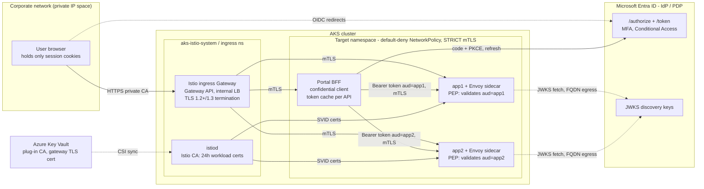
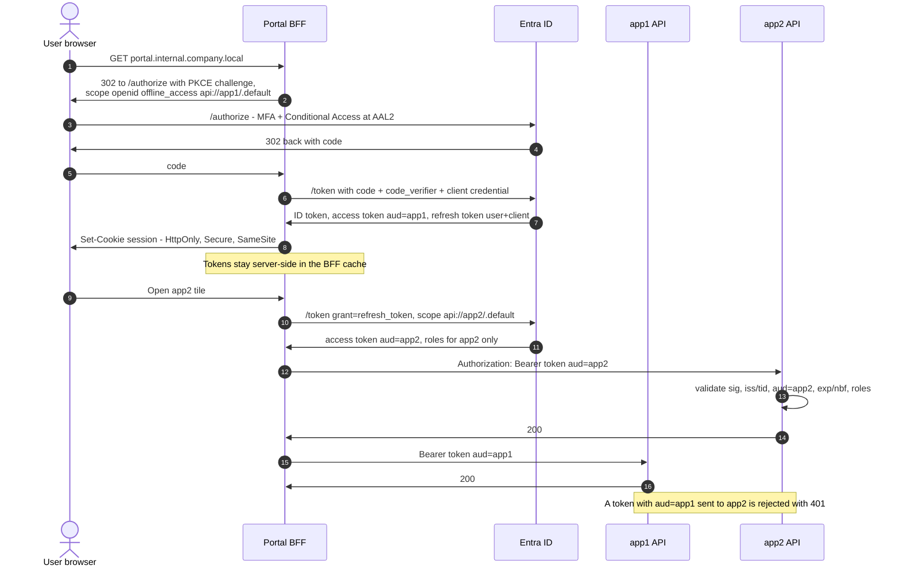
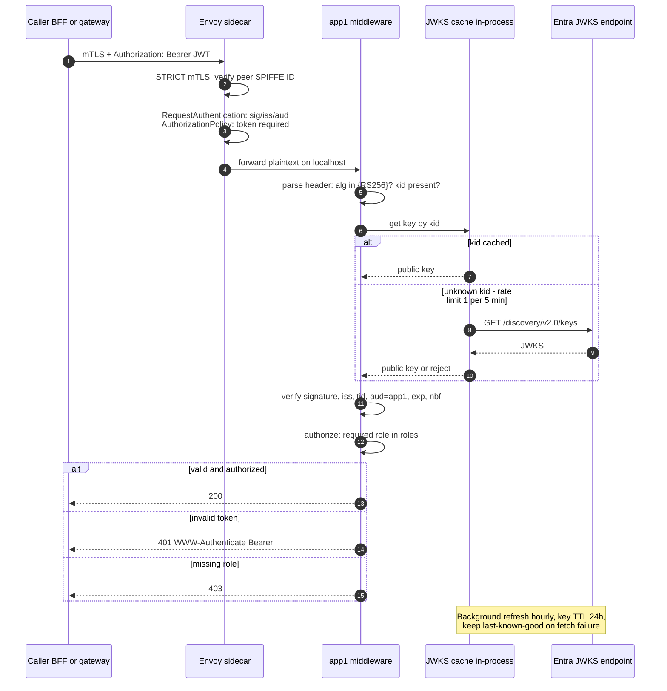
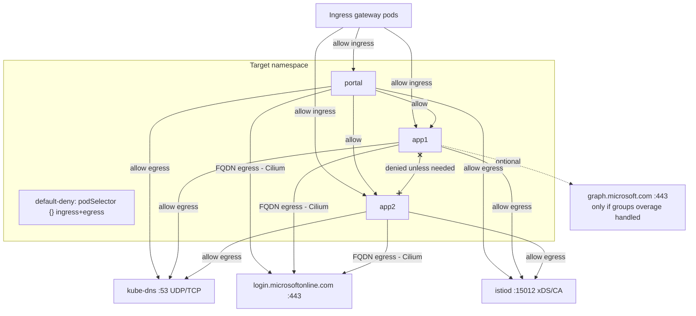
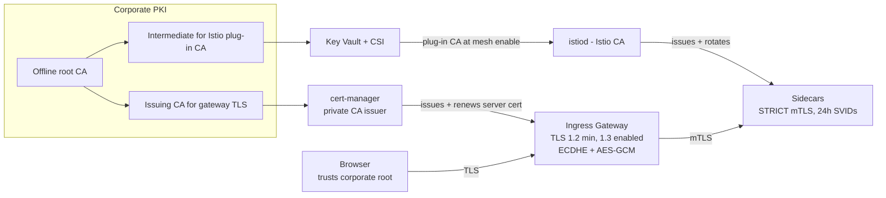
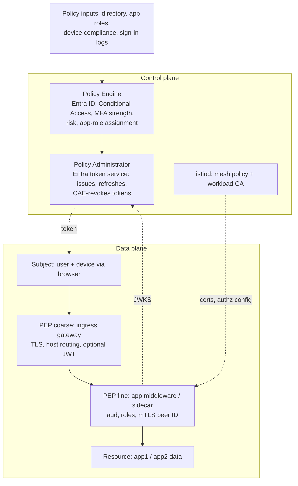

# Zero-Trust AKS Portal Architecture

Report date: 2026-11-09 · Brief: `briefs/Zero-Trust AKS Portal Architecture.md` · Notes: `research_notes/Zero-Trust AKS Portal Architecture/`

**Method.** A deep-research workflow searched five angles and fetched 26 primary sources (Microsoft Learn, IETF, NIST, Istio). It extracted 129 claims and put 49 of them through 3-vote adversarial verification. 47 were confirmed and 2 refuted. The first pass verified only identity claims, because claims were selected globally and the identity angles filled the cap. A second pass topped up the other three angles (see note 02).

**Evidence labels** used throughout:

| Label | Meaning |
|---|---|
| ✅ | Verified in this run against the full text of a primary source. |
| ⚠️ | Inference: reasoned from verified facts, not stated by a source. |
| ❓ | Unverified: from domain knowledge or a source not fetched in this run. Check before relying on it. |

---

## 1. Verdict on the brief

| Brief section | Verdict | Key point |
|---|---|---|
| 3.1 Single portal token propagated to all apps | ❌ **Wrong** ✅ | An Entra access token has one `aud`. Each API must reject other resources' tokens. Fix: one token per API from a single sign-on. |
| 3.1 `groups` claim for authorization | ⚠️ **Underspecified** ✅ | Above 200 groups the claim is dropped (overage). Use app roles. |
| 3.1 `sub`/`upn` as identity | ⚠️ **Partly wrong** ✅ | Key on `oid` or `sub`. `upn` is display-only and is not in v2 tokens by default. |
| 3.2 Ingress with namespace affinity (NGINX) | ❌ **Outdated** ✅ | Upstream ingress-nginx maintenance ended March 2026. AKS app-routing NGINX support ends November 2026. Move to Gateway API. |
| 3.3 Default-deny NetworkPolicy | ✅ **Right, incomplete** | Needs explicit allows for the ingress gateway, DNS and Entra egress. Plain NetworkPolicy cannot match FQDNs. |
| 3.3 Istio mTLS with SPIFFE/SPIRE | ⚠️ **Partly wrong** ✅ | The AKS Istio add-on issues SPIFFE-format identities from its own CA (optionally a Key Vault plug-in CA). SPIRE integration is undocumented and likely blocked ⚠️. |
| 4.1 Every app is a PEP | ✅ **Right** | Matches NIST SP 800-207A identity-based segmentation. |
| 4.1 iss/aud/exp/role validation | ✅ **Right, incomplete** | Also pin `alg`, check `tid` and `nbf`, and select the key by `kid`. |
| 4.2 TLS 1.2 minimum / TLS 1.3 | ✅ **Right** | Matches SP 800-52r2: TLS 1.2 required, TLS 1.3 support required since 2024-01-01. |
| 4.3 AAL2 12 h / 30 min reauthentication | ❌ **Misattributed** ✅ | Those are SP 800-63B Rev 3 values. Rev 4 (Aug 2025) gives AAL2 at most 24 h overall and 1 h inactivity. 12 h is AAL3. |
| 5.1 JWKS caching | ✅ **Right** | Microsoft gives concrete cache and refresh numbers (§5). |
| 5.2 Envoy `RequestAuthentication` | ⚠️ **Incomplete** ✅ | On its own it **lets requests with no token through**. It must be paired with an `AuthorizationPolicy`. |
| 5.3 Decentralized authorization resilience | ✅ **Right, with a gap** | Without CAE, a stolen token stays valid for 60–90 min. |

---

## 2. Glossary

Definitions follow the defining standard. The **Status** column shows whether this run fetched and verified that source (✅) or whether it is a reference only (❓).

### 2.1 Identity & access

| Term | Definition | Defined by | Status |
|---|---|---|---|
| **Microsoft Entra ID** | Microsoft's cloud identity provider (IdP), formerly Azure AD. In this architecture it is the authorization server. It authenticates users, enforces Conditional Access and issues ID, access and refresh tokens. In NIST 800-207 terms it is part of the policy decision point (PDP/PA) ⚠️. | Microsoft Learn | ✅ (token docs) |
| **OAuth 2.0** | An authorization framework in which a client obtains an **access token** from an authorization server and uses it to call a **resource server** (API). | RFC 6749 | ❓ |
| **OpenID Connect (OIDC)** | An identity layer on OAuth 2.0. The client receives an **ID token** stating who signed in. The ID token is for the client only and must never be sent to an API as a credential. | OIDC Core 1.0 | ❓ |
| **Authorization Code Flow + PKCE** | A redirect-based flow. The client exchanges a one-time code for tokens and proves possession of a per-request secret (`code_verifier`). This stops intercepted codes from being redeemed. At redemption, scopes must belong to **one resource** (plus OIDC scopes). | RFC 7636; Microsoft Learn | ✅ (Entra flow) / ❓ (RFC) |
| **Access token** | A credential for **one resource** (`aud`), used as a bearer token. Entra default lifetime: a random 60–90 min. | Microsoft Learn; RFC 9068 | ✅ |
| **Refresh token** | A long-lived credential bound to **user + client, not resource**. It can mint access tokens for any consented API. Lifetime: 24 h fixed for `spa` redirect URIs, 90 days otherwise. | Microsoft Learn | ✅ |
| **Bearer token** | A token that grants access to whoever presents it. Sent as `Authorization: Bearer <token>`. | RFC 6750 | ❓ |
| **JWT** | A compact, signed set of JSON claims. This is a *format*. "Bearer" is the *usage*. | RFC 7519; BCP RFC 8725 | ❓ / ✅ (8725) |
| **JWKS** | The IdP's published set of public signing keys. Validators pick the key by `kid`. Entra rotates keys without a fixed schedule. | RFC 7517; Microsoft Learn | ✅ (rollover) |
| **Audience (`aud`)** | The single intended recipient of a token. In Entra v2 it is the API's client ID. An API **must reject** a token whose `aud` is not its own (otherwise it is a confused deputy). | RFC 8725 §3.9; Microsoft Learn | ✅ |
| **`oid` / `sub` / `upn`** | `oid` is the user's immutable ID, the same for every app in the tenant. `sub` is immutable and pairwise per app. `upn` is mutable and only for display. Authorize on `oid`/`sub`. | Microsoft Learn | ✅ |
| **App roles (`roles`)** | Permissions defined on an API's app registration and assigned to users or groups. They appear in that API's access token only. This is the recommended RBAC basis. | Microsoft Learn | ✅ |
| **Group claims (`groups`)** | Group object IDs (GUIDs, not names). Above 200 groups in a JWT the claim is omitted and an overage indicator is emitted instead. | Microsoft Learn | ✅ |
| **Backend-for-Frontend (BFF)** | A server-side confidential client for a browser app. It holds tokens server-side and gives the browser only a session cookie. | IETF OAuth for Browser-Based Apps (draft BCP) | ❓ (recommendation is ⚠️) |
| **On-Behalf-Of (OBO)** | A token exchange in which an API trades an incoming token for a new one for a downstream API, keeping the user context. | Microsoft Learn | ❓ |
| **Conditional Access / authentication strengths** | Entra policy engine that requires MFA or phishing-resistant methods, sign-in frequency and similar conditions before issuing tokens. | Microsoft Learn | ❓ |
| **Continuous Access Evaluation (CAE)** | Near-real-time revocation of tokens on critical events. Both client and resource must support it. A custom API must implement the claims-challenge flow. | Microsoft Learn | ✅ |

### 2.2 Kubernetes, network & mesh

| Term | Definition | Defined by | Status |
|---|---|---|---|
| **Namespace** | A scope for names and for namespaced policies. It is *not* a security boundary on its own. Isolation comes from adding NetworkPolicy, RBAC and Pod Security Admission. | Kubernetes docs | ❓ |
| **NetworkPolicy** | L3/L4 allow-list rules for pod traffic. Once a pod is selected, all unlisted traffic in that direction is denied. Rules cannot express FQDNs; Cilium FQDN policies can. | Kubernetes docs; Microsoft Learn | ❓ / ✅ (Cilium FQDN) |
| **Ingress controller** | Implements the Kubernetes `Ingress` API (for example ingress-nginx). Upstream ingress-nginx maintenance ended in March 2026. | Kubernetes; AKS blog | ✅ (retirement) |
| **Gateway API** | The successor to Ingress. Uses role-oriented `GatewayClass`, `Gateway` and `HTTPRoute` resources. Routes attach to a Gateway only if the Gateway allows it, which supports per-namespace scoping. | Kubernetes SIG-Network; Microsoft Learn | ✅ (AKS successor) / ❓ (attachment model) |
| **Internal load balancer** | An Azure load balancer with a private frontend IP, set by Service annotation `service.beta.kubernetes.io/azure-load-balancer-internal: "true"`. | Microsoft Learn | ❓ |
| **Service mesh / sidecar** | A proxy (Envoy) beside each pod that handles mTLS, authorization and telemetry. The AKS Istio add-on supports only sidecar mode (no ambient). | Istio; Microsoft Learn | ✅ |
| **mTLS** | TLS in which both peers authenticate with X.509 certificates. It gives encryption and workload identity. Compliance with SP 800-52 depends on the configured versions and suites, not on mTLS itself. | RFC 8446; SP 800-52r2 | ✅ (800-52) |
| **PeerAuthentication** | Istio resource that sets the mTLS mode (`STRICT` rejects plaintext) mesh-wide, per namespace or per workload. | Istio | ❓ |
| **RequestAuthentication** | Istio resource that validates JWTs. It rejects *invalid* tokens but **accepts requests with no token**. | Istio | ✅ |
| **AuthorizationPolicy** | Istio resource with ALLOW/DENY rules on peer identity, `requestPrincipals` and JWT claims. Required to enforce "token present". | Istio | ✅ (pairing) / ❓ (fields) |
| **SPIFFE** | Workload identity specification. Identities are URIs such as `spiffe://<trust-domain>/ns/<ns>/sa/<sa>`, delivered as X.509 SVIDs. | SPIFFE spec | ❓ |
| **SPIRE** | One implementation of SPIFFE (server and agents). Optional: Istio's own CA already issues SPIFFE-format identities ❓. Not documented for the AKS add-on ✅. | CNCF SPIFFE project | ✅ (absence) |
| **Istio CA / plug-in CA** | The add-on's built-in CA, which by default signs from a self-signed root. A plug-in CA brings your own root and intermediate through Key Vault. It can only be chosen when the mesh is enabled. Workload certificates last 24 h. | Microsoft Learn | ✅ |
| **cert-manager / trust-manager** | Kubernetes controllers. cert-manager issues and renews certificates, for example the gateway TLS certificate from a private CA issuer. trust-manager distributes CA bundles. | cert-manager.io | ❓ |

### 2.3 Zero Trust & assurance

| Term | Definition | Defined by | Status |
|---|---|---|---|
| **Zero Trust Architecture (ZTA)** | Grants no implicit trust based on network location. Access is granted **per session** under **dynamic policy**. "Never trust, always verify" is industry shorthand, not NIST wording. | NIST SP 800-207 | ❓ (base doc not fetched) |
| **PEP / PDP / PA** | The policy enforcement point (PEP) gates the resource. The policy decision point (PDP) is made up of the policy engine, which decides, and the policy administrator (PA), which issues or revokes session credentials. | NIST SP 800-207 | ❓ |
| **Identity-based segmentation** | Authorization based on application and service identity, enforced by API gateways, sidecars and SPIFFE-style identity, *in addition to* network segmentation. | NIST SP 800-207A | ✅ |
| **"Verify explicitly"** | Microsoft's Zero Trust principle, not a NIST term. Token lifetimes (60–90 min) make it per-token rather than per-request unless CAE is used. | Microsoft Zero Trust guidance | ❓ / ⚠️ |
| **AAL2** | Authenticator assurance level 2. Two distinct factors. Per Rev 4: reauthenticate at most every **24 h** overall and after **1 h** of inactivity. At least one **phishing-resistant** option must be *offered*. | NIST SP 800-63B Rev 4 | ✅ |
| **Single-entry portal (launchpad)** | The UI that discovers apps and starts single sign-on. In the corrected design it **does not hand one token to every app** (§4). | This report | ⚠️ |
| **App-level authorization** | Each app (or its sidecar) acts as its own PEP. It validates signature, `iss`/`tid`, `aud`, `exp`/`nbf` and `alg`, then applies local role policy. | RFC 8725; Microsoft Learn; SP 800-207A | ✅ |

---

## 3. Corrected reference architecture

### 3.1 Components and roles



*Figure 1. Solid edges: request and data paths. Dotted edges: control and identity paths. Facts behind each part:*
- *✅ Verified: token per API (F1, F2), the 24 h workload certificate and plug-in CA via Key Vault (F9), Gateway API as the successor to NGINX (F7), the need for JWKS egress (F6).*
- *⚠️ Inference: where the ingress gateway lives (its namespace) and whether JWKS is fetched by the app or by istiod.*

| Component | Role | Zero-Trust contribution |
|---|---|---|
| **Entra ID** | IdP and authorization server | Authenticates users at AAL2 (MFA, Conditional Access) and mints audience-bound tokens. It is the PDP/PA for user access ⚠️. |
| **Portal BFF** | Single entry point; confidential OIDC client | Single sign-on; gets **one token per API** silently; keeps tokens out of the browser ⚠️. |
| **Ingress Gateway** (Istio, Gateway API) | Network entry; TLS termination; host routing | Coarse PEP: TLS to SP 800-52r2, explicit hostnames only. It can also pre-validate JWTs, but apps must not rely on that ⚠️. |
| **app1 / app2** (+ sidecar) | Business APIs and UIs | **Fine-grained PEP**. Validates its own `aud` and `roles` locally ✅. |
| **istiod / Istio CA** | Mesh control plane | Issues 24 h SPIFFE-format workload certs. Enforces STRICT mTLS ✅. |
| **NetworkPolicy** (Cilium) | L3/L4 micro-segmentation | Default-deny with explicit allow paths. A defense-in-depth layer per 800-207A ✅. |
| **Key Vault** | Secret and key store | Root and intermediate for the plug-in CA, gateway TLS cert ✅/❓. |

---

## 4. Token flow: one sign-on, one token per API

### 4.1 Why "one token for all apps" fails ✅

- **One resource per token.** At code redemption, "the scopes must all be from a single resource, along with OIDC scopes". If a refresh request spans several resources, Entra returns a token only for the **first** scope's resource ([auth-code flow][ms-authcode]).
- **Single audience.** In a v2 token, `aud` "is always the client ID of the API". APIs "must only accept tokens containing one of their AppId URIs as the aud claim"; anything else is the **confused-deputy** problem ([access tokens][ms-at], [claims ref][ms-claims]).
- **Standards agree.** RFC 8725 §3.9: the relying party "MUST validate the audience value" ([RFC 8725][rfc8725]).
- **The only workaround defeats the purpose.** All apps could share one app registration, and so one `aud` and one role set. That does technically work, but the apps collapse into a single resource. Per-app least privilege is lost, and a token stolen from app1 replays against app2 ⚠️.

The consequence is not "the token carries all roles". It is "**each API's token carries only that API's roles**".

### 4.2 Sign-on and per-API token acquisition



*Figure 2. Steps 1–9: one interactive sign-in. Steps 10–12: a silent per-API token from the refresh token. That refresh tokens are bound to user+client, not resource, is ✅ ([refresh tokens][ms-rt]). Consent for app2 must already exist. Admin consent or a multi-resource `/authorize` scope can provide it ✅.*

### 4.3 Portal pattern choice

| Pattern | How tokens reach apps | Pros | Cons |
|---|---|---|---|
| **A. BFF calls app APIs** (Fig. 2) | The BFF holds tokens and calls each API with that API's token | No tokens in the browser ⚠️. Refresh token lasts 90 days, not the 24 h `spa` limit ✅. | The BFF is a proxy hop and a high-value target. Apps become APIs behind the portal. |
| **B. Launchpad + per-app OIDC** | Each app is its own confidential client. The portal only shows links. SSO comes from the Entra session cookie. | Strongest isolation. No token is ever shared ⚠️. | N app registrations and N client sign-ins (silent). |
| **C. Pure SPA + MSAL** | MSAL in the browser calls `acquireTokenSilent` per API scope and calls APIs cross-origin | No backend. | Tokens live in browser JS. Refresh token is a fixed 24 h ✅. Needs CORS on every app ⚠️. |

**Recommendation ⚠️:** B for apps with their own UI, A for API-only apps. Avoid C for internal enterprise apps. A browser's storage is per-origin, so a token stored on `portal.…` can't be read by script on `app1.…` (❓, browser same-origin rule). That is why the brief's "browser retains token and appends it to every app" only works as pattern C.

### 4.4 Token content: what each app can rely on ✅

| Claim | Use | Note |
|---|---|---|
| `aud` | Must equal *this* app's client ID | Set `requestedAccessTokenVersion: 2` on every API so `aud` is the GUID and `iss` is the v2.0 issuer ([access tokens][ms-at]). |
| `iss` + `tid` | Must equal your tenant | Entra's common JWKS is shared across tenants, so the key alone doesn't prove the tenant ([RFC 8725 §3.8][rfc8725]; applying this to `tid` is ⚠️). |
| `oid` / `sub` | Authorization and DB key | `upn`/`preferred_username` are mutable; display only ([claims ref][ms-claims]). |
| `roles` | Authorization decision | App roles defined on this app's registration. No overage problem ✅. |
| `groups` | Avoid | Overage above 200. If you must use it, emit "Groups assigned to the application" (P1, direct membership only) or call Graph `transitiveMemberOf`, which needs Graph egress and permissions ([group claims][ms-groups]). |
| `exp` / `nbf` | Reject if outside the window | Default access token lifetime is a random 60–90 min ([token lifetimes][ms-ctl]). |

---

## 5. Per-request validation inside each app



*Figure 3. Two independent enforcement points: the sidecar, which is optional and coarse, and the app middleware, which is mandatory and fine-grained. Sources:*
- *✅ Verified: the cache numbers come from Microsoft's [signing-key rollover][ms-rollover] guidance. Standard libraries refresh about every 12 h ± 1 h and keep the last-known-good configuration.*
- *❓ Unverified: whether a CAE claims-challenge path (401 with `insufficient_claims`) can be added is not covered in this run's sources.*

### 5.1 Validation checklist ✅ (RFC 8725, Microsoft Learn)

1. **Algorithm allow-list.** Pass an explicit list (`RS256`) and never trust the header's `alg`. Libraries "MUST enable the caller to specify a supported set of algorithms" (§3.1).
2. **Key by `kid`.** v2 tokens carry only `kid`, not `x5t`. Never hard-code keys; Entra may roll them "immediately" in an emergency.
3. **Issuer and tenant.** Check `iss` == `https://login.microsoftonline.com/<tid>/v2.0` and `tid` == your tenant.
4. **Audience.** Check `aud` == this API's client ID, and nothing else.
5. **Time.** Check `exp` and `nbf`, with small clock skew (⚠️ ≤ 5 min is common practice ❓).
6. **Authorization.** Required app role in `roles`. Key on `oid`, never on `upn`.
7. **Failures.** Return 401 for authentication failures and 403 for authorization failures. Reject malformed tokens before any business logic.

### 5.2 Illustrative Python middleware core ❓

Library behaviour (`PyJWKClient` caching parameters) was **not verified in this run**. Check it against the PyJWT docs for your version.

```python
import jwt  # PyJWT >= 2.x
from jwt import PyJWKClient

TENANT = "<tenant-guid>"
API_CLIENT_ID = "<app1-client-id>"
ISSUER = f"https://login.microsoftonline.com/{TENANT}/v2.0"
_jwks = PyJWKClient(
    f"https://login.microsoftonline.com/{TENANT}/discovery/v2.0/keys",
    cache_jwk_set=True, lifespan=3600,  # refresh hourly (MS guidance)
)

def authorize(token: str, required_role: str) -> dict:
    key = _jwks.get_signing_key_from_jwt(token)  # selects by kid; refetches on miss
    claims = jwt.decode(
        token, key.key,
        algorithms=["RS256"],                 # pinned, RFC 8725 §3.1
        audience=API_CLIENT_ID, issuer=ISSUER,
        options={"require": ["exp", "nbf", "iss", "aud", "tid", "oid"]},
        leeway=60,
    )
    if claims["tid"] != TENANT:
        raise jwt.InvalidTokenError("tenant mismatch")
    if required_role not in claims.get("roles", []):
        raise PermissionError("missing role")  # map to 403
    return claims
```

Rate-limiting the refetch on unknown `kid` (at most once per 5 min) and keeping the last-known-good keys during an Entra outage must be added or confirmed for your library ⚠️. .NET `Microsoft.Identity.Web` does this through `BaseConfigurationManager` ✅ (inference that it uses it ⚠️).

---

## 6. Ingress and boundary enforcement

**Verified facts ✅** ([AKS blog][aks-nginx], [migration guide][aks-gw-mig], [app-routing Gateway API][aks-gw]):
- **NGINX support.** Upstream ingress-nginx maintenance ended in March 2026. Microsoft supports the app-routing add-on's NGINX only **through November 2026**, with critical security patches only. **A new design should not use it.**
- **`approuting-istio` successor.** The supported successor for app routing is the Gateway API implementation `GatewayClass approuting-istio`. It is a lightweight Istio control plane with no Istio CRDs and no sidecar injection.
- **Conflict with the mesh.** `approuting-istio` **cannot coexist with the Istio service-mesh add-on**: it fails to start while `*.istio.io` CRDs are present.
- **What that means here.** This architecture needs STRICT mTLS (§8), so the ingress must be the **Istio add-on's own Gateway API ingress** (`GatewayClass istio`) or **Application Gateway for Containers**.

**Recommendations ⚠️/❓** (not verified in this run):
- **Internal only.** Front the gateway with an internal LB (`service.beta.kubernetes.io/azure-load-balancer-internal: "true"`) and do not create any public frontend.
- **Explicit hostnames.** Use explicit `hostnames` per `HTTPRoute` (`app1.internal.company.local`). Use no wildcard listeners and no catch-all route. Unmatched hosts should get 404 from the gateway, not a default backend.
- **Restrict route attachment.** On the `Gateway` listener, set `allowedRoutes.namespaces.from: Selector` limited to the target namespace. That way, routes from other namespaces cannot attach and intercept traffic.
- **TLS secret placement.** Keep the TLS secret where the Gateway lives. Cross-namespace certificate references need an explicit `ReferenceGrant`.
- **Hostname choice.** `.local` is reserved for mDNS (RFC 6762 ❓). Prefer an internal subdomain of a domain you own (`*.internal.company.com`) to avoid resolver conflicts.

---

## 7. Micro-segmentation and egress



*Figure 4. Allowed paths under default-deny. Edge evidence:*
- *✅ Verified: FQDN egress needs Cilium with DNS proxying ([FQDN filtering][aks-fqdn]). On Cilium, default-deny-ingress also blocks LoadBalancer and NodePort traffic ([NPM→Cilium][aks-npm]).*
- *⚠️ Inference: the istiod port (15012) and the need for sidecar-to-istiod egress (❓ upstream Istio default). Lateral app1↔app2 is denied unless a business flow requires it.*

**Verified facts ✅:**
- **Default-deny also blocks the load balancer path on Cilium.** On Azure CNI powered by Cilium, default-deny-ingress also blocks traffic arriving via LoadBalancer/NodePort Services with `externalTrafficPolicy=Cluster` (Azure NPM did not). Gateway pods and LB source ranges must be explicitly allowed.
- **FQDN egress mechanics.** FQDN egress works through the ACNS security agent's DNS proxy, and only for pods with FQDN policies. Those policies **must allow kube-dns:53 with a DNS `matchPattern` rule**, or the FQDN-to-IP mapping is never learned.
- **Standard NetworkPolicy cannot match FQDNs.** Entra's endpoints are CDN-backed and change IP, so IP-based allow-lists are fragile ⚠️.

**Refuted or open:** the claim that FQDN filtering requires paid ACNS on Kubernetes 1.29+ was refuted 1-2 as stated. **The exact licensing and version prerequisites remain open.** Alternatives are Azure Firewall FQDN rules or service tags on the egress path ❓.

**JWKS egress subtlety ❓.** In upstream Istio, `RequestAuthentication.jwksUri` is by default resolved by **istiod**, not by the sidecar. If that holds for the add-on, the app namespace needs Entra egress only for in-app validation and the portal's token calls, while istiod's namespace needs it for mesh-level JWT checks. This was not verified.

---

## 8. Service mesh, mTLS and workload identity

**Verified facts ✅** ([Istio add-on][aks-istio], [plug-in CA][aks-pca], [RequestAuthentication][istio-ra]):
- **Sidecar mode only.** The AKS Istio add-on does **not** support ambient mode.
- **Blocked customization.** `ProxyConfig`, `WorkloadEntry`, `WorkloadGroup`, `IstioOperator` and `WasmPlugin` are blocked. MeshConfig is partly supported.
- **Default CA.** The Istio CA signs from a **self-signed root** by default. Workload certificates are **valid 24 h**.
- **Plug-in CA.** Supplied as root cert, intermediate cert and key, and chain, stored in Key Vault and synced by the Secrets Store CSI add-on. It must be passed when enabling the mesh. **A running self-signed mesh cannot be switched in place.**
- **No SPIRE.** Microsoft documents **no SPIFFE/SPIRE integration**. That SPIRE is impractical on the add-on is ⚠️ inference from the blocked customizations. If SPIRE federation is a hard requirement, self-managed open-source Istio is the path. That is an open question, not verified.
- **RequestAuthentication alone does not enforce authentication.** "A request that does not contain any authentication credentials will be accepted but will not have any authenticated identity." It must be paired with an `AuthorizationPolicy` (verified 2-1; the primary text is unambiguous).

**Brief correction.** Plan on the add-on's own CA with a **plug-in CA from the start**, chained to the corporate PKI. Istio already issues SPIFFE-format identities ❓, so "SPIFFE identities" holds. "SPIRE" does not.

### 8.1 Illustrative mesh policy ❓ (field names from upstream Istio, not verified for the add-on revision)

```yaml
apiVersion: security.istio.io/v1
kind: PeerAuthentication
metadata: { name: default, namespace: apps }
spec: { mtls: { mode: STRICT } }
---
apiVersion: security.istio.io/v1
kind: RequestAuthentication
metadata: { name: entra, namespace: apps }
spec:
  selector: { matchLabels: { app: app1 } }
  jwtRules:
  - issuer: "https://login.microsoftonline.com/<tid>/v2.0"
    jwksUri: "https://login.microsoftonline.com/<tid>/discovery/v2.0/keys"
    audiences: ["<app1-client-id>"]
    forwardOriginalToken: true          # app re-validates (defense in depth)
---
apiVersion: security.istio.io/v1
kind: AuthorizationPolicy
metadata: { name: app1-require-jwt, namespace: apps }
spec:
  selector: { matchLabels: { app: app1 } }
  action: ALLOW
  rules:
  - from:
    - source:
        principals: ["cluster.local/ns/<gw-ns>/sa/<gw-sa>", "cluster.local/ns/apps/sa/portal"]
        requestPrincipals: ["https://login.microsoftonline.com/<tid>/v2.0/*"]
    when:
    - key: request.auth.claims[roles]
      values: ["App1.Read", "App1.Admin"]
```

---

## 9. Transport security and certificate lifecycle



*Figure 5. Two chains under one corporate root. Evidence:*
- *✅ Verified: the plug-in CA via Key Vault and the 24 h SVIDs (§8). SP 800-52r2 requires TLS 1.2 support plus TLS 1.3 support since 2024-01-01 ([SP 800-52r2][nist-52]).*
- *❓ Unverified: cert-manager as the issuer of the gateway certificate.*
- *❓ Note: the binding TLS 1.3 requirement applies to servers, and the cipher-suite detail comes from the verifier's recollection of the PDF. The publication page says SP 800-52r2 has been under review since May 2026.*

---

## 10. NIST alignment



*Figure 6. Mapping of NIST SP 800-207 logical components onto the corrected architecture.*
- *⚠️ Inference: the whole mapping. Base SP 800-207 was not fetched in this run.*
- *✅ Verified: the 800-207A basis ([SP 800-207A][nist-207a]). It moves the focus from network-parameter segmentation to identity-based authentication and authorization, enforced by "API gateways, sidecar proxies, and application identity infrastructures (e.g., SPIFFE)", **in addition to** network controls.*

**SP 800-63B Rev 4 at AAL2 ✅** ([800-63B-4][nist-63b]):

| Requirement | Rev 4 value | Brief said | Action |
|---|---|---|---|
| Overall reauthentication timeout | SHALL be set; SHOULD ≤ **24 h** | 12 h | 12 h is stricter and still compliant, but label it as policy, not "AAL2". |
| Inactivity timeout | SHOULD ≤ **1 h** | 30 min | Same. |
| Phishing-resistant option | SHALL be **offered** at AAL2 | — | Offer passkeys/FIDO2 or certificate-based auth through Entra authentication strengths ⚠️ (Entra mapping not verified). |
| AAL3 (for contrast) | ≤ 12 h overall, ≤ 15 min inactivity | — | — |

**Mapping to Entra ⚠️:** Conditional Access "sign-in frequency" governs reauthentication *at Entra*. It does **not** end the portal's own session. The BFF session cookie also needs idle and absolute timeouts no looser than the chosen values.

---

## 11. Trade-off analysis

| Trade-off (brief §5) | Finding | Recommendation |
|---|---|---|
| **5.1 Security vs latency** | Signature checks are local CPU work. Network cost exists only on a JWKS miss. Microsoft's cache guidance is a 24 h key TTL, hourly background refresh, unknown-`kid` refresh at most every 5 min, and last-known-good on failure ✅. | Use a standard library. Never fetch JWKS on the request path except on an unknown `kid`. An Entra outage then degrades only *new sign-ins*, not validation ⚠️. |
| **5.2 Library vs sidecar** | `RequestAuthentication` fails open without an `AuthorizationPolicy` ✅. Ambient mode is not available on the add-on ✅. | Two layers. The sidecar enforces token presence, `iss` and `aud`, and mTLS peer identity. A **shared, versioned middleware package** per language does `aud`, `roles` and `tid`. Apps must not trust `x-jwt-payload` or similar headers alone, because that is the header-injection pattern the brief excluded ⚠️. |
| **5.3 Central vs decentralized** | Per-app `aud` checks are what contain a compromised gateway or portal. A token for app1 is useless at app2 ✅/⚠️. | Keep the gateway coarse and the apps authoritative. The BFF (pattern A) re-centralizes token custody, so harden it as a tier-0 component ⚠️. |
| **Revocation gap** (new) | Without CAE, a stolen access token is valid for 60–90 min. With CAE-capable client and API, tokens may live 24–28 h with near-real-time revocation ✅. | Either implement CAE claims challenges in the app middleware (❓ library support), or accept ≤ 90 min exposure and rely on mTLS plus network restriction to limit replay ⚠️. |

---

## 12. Brief corrections at a glance

| # | Brief text | Correction |
|---|---|---|
| 1 | "Browsers retain the Access Token and append it on all API requests sent to downstream applications" | One token **per API**. Use a BFF or per-app OIDC clients. Tokens stay out of the browser where possible. |
| 2 | "Access Tokens containing `sub`/`upn`, `groups`, `roles`" | `oid`/`sub` plus that API's `roles`. Avoid `groups` (overage). `upn` is display-only and must be added as an optional claim in v2. |
| 3 | "Ingress controllers operate with strict namespace affinity" (NGINX) | Istio add-on Gateway API, or App Gateway for Containers, on an internal LB. Restrict routes with `allowedRoutes`. NGINX is end-of-support. |
| 4 | "Short-lived SPIFFE/SPIRE identity certificates" | Istio CA with a plug-in CA from Key Vault; 24 h SPIFFE-format certs. SPIRE is not available on the add-on. |
| 5 | "Envoy `RequestAuthentication`" as the enforcement | Only with an `AuthorizationPolicy` requiring `requestPrincipals` and roles. |
| 6 | Default-deny ingress + egress | Add explicit allows for the gateway, kube-dns, istiod, and Entra via Cilium FQDN policy (or a firewall). |
| 7 | AAL2 implicitly 12 h / 30 min | Rev 4 AAL2 is ≤ 24 h / ≤ 1 h. Offer a phishing-resistant method. |
| 8 | `*.internal.company.local` | Consider a subdomain of an owned domain; `.local` collides with mDNS ❓. |

---

## 13. Gaps, refuted claims and open questions

**Not verified in this run** (glossary and recommendations above are marked ❓ where they depend on these):
- **Ingress controls:** `--watch-namespace` and IngressClass scoping; default-backend and wildcard risks; TLS secret scoping and `ReferenceGrant`; the internal LB annotation.
- **Certificates:** cert-manager, trust-manager, and the Key Vault CSI driver for gateway TLS.
- **JWT library behaviour:** the Envoy `jwt_authn` JWKS cache, PyJWT and jose.
- **Standards and status not fetched:** the IETF Browser-Based Apps BCP, RFC 9068 and RFC 6750 (cited secondhand only), the SP 800-207 base tenets, and the Azure NPM deprecation timeline.

**Refuted:**
- "FQDN filtering requires paid ACNS + Kubernetes 1.29+" (1-2). The prerequisites remain uncertain, not disproven.
- A characterisation of the Istio add-on support-policy tiers (0-3).

**Open questions** (candidates for a `… verified` follow-up on this branch):
1. Exact prerequisites for AKS FQDN filtering, and whether Azure Firewall FQDN rules are a supported alternative for Entra and Graph egress.
2. Envoy/istiod JWKS cache behaviour compared with Microsoft's 24 h / 1 h / 5 min guidance during a key rollover or an Entra outage.
3. Practical CAE claims-challenge support for custom APIs (Microsoft.Identity.Web, Python).
4. If SPIRE federation is mandatory: is self-managed Istio, or a managed ambient offering, production-ready on AKS?

**Time sensitivity.** Several findings are dated: the NGINX end of support (this month), Gateway API and mesh feature sets, and the SP 800-52r2 revision now under review. Re-check them before implementation.

---

## Sources

All of the following were fetched and used by verifiers in this run.

**Microsoft Entra ID**
- [ms-authcode]: https://learn.microsoft.com/en-us/entra/identity-platform/v2-oauth2-auth-code-flow
- [ms-at]: https://learn.microsoft.com/en-us/entra/identity-platform/access-tokens
- [ms-claims]: https://learn.microsoft.com/en-us/entra/identity-platform/access-token-claims-reference
- [ms-ctl]: https://learn.microsoft.com/en-us/entra/identity-platform/configurable-token-lifetimes
- [ms-rt]: https://learn.microsoft.com/en-us/entra/identity-platform/refresh-tokens
- [ms-groups]: https://learn.microsoft.com/en-us/security/zero-trust/develop/configure-tokens-group-claims-app-roles
- [ms-rollover]: https://learn.microsoft.com/entra/identity-platform/signing-key-rollover
- [ms-claimsval]: https://learn.microsoft.com/entra/identity-platform/claims-validation
- [ms-cae]: https://learn.microsoft.com/entra/identity-platform/app-resilience-continuous-access-evaluation
- [ms-aal2]: https://learn.microsoft.com/entra/standards/nist-authenticator-assurance-level-2

**IETF**
- [rfc8725]: https://www.rfc-editor.org/rfc/rfc8725
- [rfc9068]: https://rfc-editor.org/rfc/rfc9068.html (fetched; its claims were not among those verified)

**AKS**
- [aks-nginx]: https://blog.aks.azure.com/2025/11/13/ingress-nginx-update
- [aks-gw-mig]: https://learn.microsoft.com/azure/aks/app-routing-nginx-to-gateway-api-migration
- [aks-gw]: https://learn.microsoft.com/azure/aks/app-routing-gateway-api
- [aks-fqdn]: https://learn.microsoft.com/en-us/azure/aks/container-network-security-fqdn-filtering-concepts
- [aks-npm]: https://learn.microsoft.com/en-us/azure/aks/migrate-from-npm-to-cilium-network-policy
- [aks-istio]: https://learn.microsoft.com/en-us/azure/aks/istio-about
- [aks-pca]: https://learn.microsoft.com/en-us/azure/aks/istio-plugin-ca
- [aks-istio-sp]: https://learn.microsoft.com/en-us/azure/aks/istio-support-policy

**Istio**
- [istio-ra]: https://istio.io/latest/docs/reference/config/security/request_authentication/
- [istio-authn]: https://istio.io/latest/docs/tasks/security/authentication/authn-policy/

**NIST**
- [nist-207a]: https://csrc.nist.gov/pubs/sp/800/207/a/final
- [nist-52]: https://csrc.nist.gov/pubs/sp/800/52/r2/final
- [nist-63b]: https://pages.nist.gov/800-63-4/sp800-63b.html

**Other**
- [osv-jwt]: https://osv.dev/GHSA-fhv5-28vv-h8m8 (fetched; no claim used)

[ms-authcode]: https://learn.microsoft.com/en-us/entra/identity-platform/v2-oauth2-auth-code-flow
[ms-at]: https://learn.microsoft.com/en-us/entra/identity-platform/access-tokens
[ms-claims]: https://learn.microsoft.com/en-us/entra/identity-platform/access-token-claims-reference
[ms-ctl]: https://learn.microsoft.com/en-us/entra/identity-platform/configurable-token-lifetimes
[ms-rt]: https://learn.microsoft.com/en-us/entra/identity-platform/refresh-tokens
[ms-groups]: https://learn.microsoft.com/en-us/security/zero-trust/develop/configure-tokens-group-claims-app-roles
[ms-rollover]: https://learn.microsoft.com/entra/identity-platform/signing-key-rollover
[rfc8725]: https://www.rfc-editor.org/rfc/rfc8725
[aks-nginx]: https://blog.aks.azure.com/2025/11/13/ingress-nginx-update
[aks-gw-mig]: https://learn.microsoft.com/azure/aks/app-routing-nginx-to-gateway-api-migration
[aks-gw]: https://learn.microsoft.com/azure/aks/app-routing-gateway-api
[aks-fqdn]: https://learn.microsoft.com/en-us/azure/aks/container-network-security-fqdn-filtering-concepts
[aks-npm]: https://learn.microsoft.com/en-us/azure/aks/migrate-from-npm-to-cilium-network-policy
[aks-istio]: https://learn.microsoft.com/en-us/azure/aks/istio-about
[aks-pca]: https://learn.microsoft.com/en-us/azure/aks/istio-plugin-ca
[istio-ra]: https://istio.io/latest/docs/reference/config/security/request_authentication/
[nist-207a]: https://csrc.nist.gov/pubs/sp/800/207/a/final
[nist-52]: https://csrc.nist.gov/pubs/sp/800/52/r2/final
[nist-63b]: https://pages.nist.gov/800-63-4/sp800-63b.html
